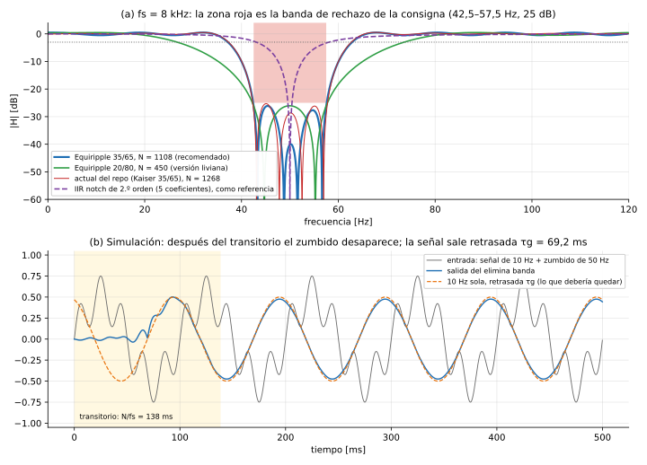

# TP2 – Análisis de diseño del filtro FIR elimina banda

- **Consigna:** elimina banda.
- **Fr = 50 Hz**, **Bw = 15 Hz**, **Astop = 25 dB**.
- FIR procesado por muestras.
- Para fs = 8, 16, 22, 44 y 48 kHz, en la FRDM-MCXN947 (Cortex-M33 a 150 MHz) con CMSIS-DSP en Q15.

Este documento sigue el mismo esquema que los análisis del [pasa altos](analisis-filtro-pasa-altos.md), del [pasa bajos](analisis-filtro-pasa-bajos.md) y del [pasa banda](analisis-filtro-pasa-banda.md). La teoría está en [`teoria-tp2-filtros-fir.md`](teoria-tp2-filtros-fir.md).

Es el típico **filtro de "ruido de línea"**: elimina los 50 Hz de la red eléctrica, que se acoplan a casi cualquier señal medida.

---

## 0. Resumen y veredicto

| | Recomendación |
|---|---|
| Interpretación de "Bw = 15 Hz" | **Ancho de la banda de rechazo**: de 42,5 a 57,5 Hz la atenuación tiene que ser ≥ 25 dB |
| Método en `filterDesigner` | **FIR → Equiripple**, **Minimum order** |
| Especificaciones (diseño fiel) | **Fpass1 = 35 Hz, Fstop1 = 42,5 Hz, Fstop2 = 57,5 Hz, Fpass2 = 65 Hz, Apass = 1 dB, Astop = 26 dB** |
| Orden / taps | 8k: 1108 (1110 taps) · 16k: ≈ 2216 · 22k: ≈ 3048 · 44k: ≈ 6094 · 48k: ≈ 6648 |
| Comparado con el diseño actual del repo | El actual (Kaiser, mismos bordes) usa 1270…7604 taps; el recomendado usa **≈ 13 % menos** |
| Retardo de grupo | ≈ 69 ms en todas las fs |
| Tiempo real con `arm_fir_q15` | **Solo entra a 8 kHz** (54 %) |

**Lo que distingue a este filtro:**

1. **Es el más caro de los cuatro.** Tiene dos transiciones de 7,5 Hz cada una, en una zona muy baja (50 Hz), y el orden es proporcional a fs/Δf. Es más del cuádruple que el pasa altos.
2. **El costo lo decide dónde se ponen los bordes de paso**, que la consigna no fija. Alejarlos de 50 Hz abarata mucho, pero el filtro empieza a atenuar frecuencias que no tendría que tocar (§5).
3. **Equiripple ahorra menos que en el pasa altos**: 13 % frente al Kaiser del repo y 10–25 % frente al mejor Kaiser que cumple. Acá δp y δs son casi iguales, que es justo la condición en la que las ventanas desperdician menos (§4).
4. **Ningún FIR razonable entra a 22 kHz o más.** En cambio, un **IIR notch de 2.º orden** (5 coeficientes) cumple la especificación exacta en todas las fs (§10). Es la conclusión natural para el informe.

---

## 1. Qué dice la consigna y qué deja abierto

| Parámetro | ¿Lo da la consigna? | Qué decidimos |
|---|---|---|
| Fs | Sí (5 valores) | Un diseño por cada fs |
| Fr (centro) | Sí: 50 Hz | — |
| Bw (ancho) | Sí: 15 Hz | Banda de rechazo de 42,5 a 57,5 Hz (§1.1) |
| Fpass1, Fpass2 (bordes de paso) | **No** | 35 y 65 Hz (diseño fiel) o más lejos (versión liviana, §5) |
| Apass | **No** | 1 dB |
| Astop | Sí: 25 dB | 26 dB (margen para Q15) |
| Método y orden | **No** | Equiripple, orden mínimo |

### 1.1 Dos maneras de leer "Bw = 15 Hz"

| Interpretación | Qué significa | Bandas para la herramienta | Orden a 8 kHz* |
|---|---|---|---|
| **A. Bw = ancho de la banda de rechazo** (recomendada) | de 42,5 a 57,5 Hz, ≥ 25 dB | Fstop1 = 42,5, Fstop2 = 57,5. Los bordes de paso se eligen afuera (35/65) | **1104** |
| B. Bw = ancho a −3 dB | a 42,5 y 57,5 Hz la atenuación es 3 dB, y en 50 Hz ≥ 25 dB | Fpass1 = 42,5, Fpass2 = 57,5, y una banda de rechazo angosta alrededor de 50 Hz (por ejemplo 48–52 o 49–51) | 1238 (49–51) · 1734 (48–52) |

\* Equiripple, Apass = 1 dB, Astop = 25 dB.

La **B** es la definición clásica de un notch (la que usa un IIR), pero en FIR **es más cara**: las transiciones quedan más angostas (5,5 a 6,5 Hz). La **A** es la que usó el diseño actual del repo y la que se lee directo en los campos de `filterDesigner`.

**El diseño actual del repo** se reproduce con `kaiserord` usando Fpass1 = 35, Fstop1 = 42,5, Fstop2 = 57,5, Fpass2 = 65, Apass = 1 y Astop = 25. Da exactamente 1270 / 2536 / 3486 / 6970 / 7604 taps. Medido con los coeficientes Q15:

- **cumple los 25 dB de la consigna** en todas las fs (peor caso −25,3 dB);
- su ripple en la banda de paso llega a +0,53 dB, un poco más que los ±0,5 dB de Apass = 1 dB. No es un requisito de la consigna, pero muestra que el diseño quedó justo.

---

## 2. Cómo se carga en `filterDesigner`

- **Response Type: Bandstop.**
- Frequency Specifications: **Fpass1, Fstop1, Fstop2, Fpass2**.
- Magnitude Specifications: **Apass1, Astop, Apass2**. Ponemos los dos Apass iguales.
- **El orden tiene que ser par** (FIR tipo I), por la misma razón que el pasa altos: la banda de paso llega hasta Nyquist. La cantidad de coeficientes N + 1 es impar, así que se agrega el cero de relleno para CMSIS.

---

## 3. Cómo se hizo este análisis

- Igual que los otros: Equiripple con `remez` de scipy, mínimos cuadrados con `firls`, ventanas con `firwin` y `kaiserord` con la fórmula de MATLAB, verificando la respuesta real antes y después de Q15.
- Además, para el elimina banda **cada orden mínimo de Equiripple a 8 kHz se confirmó con un diseño minimax exacto por programación lineal**, que da el mismo óptimo que Parks-McClellan, sin depender de que `remez` converja.
- Se verificó que **no hay "bulto" en las transiciones** (el problema del pasa banda), porque las dos transiciones son del mismo ancho.
- A 16 kHz y más, `remez` no converge. Los órdenes salen de escalar con fs. La regla se verificó con programación lineal a 16 kHz: bordes 20/80 dan N = 450 a 8 kHz y **exactamente 900** a 16 kHz. Esos valores van marcados con "≈".

---

## 4. Comparación de métodos (fs = 8 kHz)

Orden mínimo N que cumple Apass = 1 dB y Astop = 25 dB, verificado con la respuesta real.

| Bordes de paso | Equiripple | Least-squares | Kaiser (`kaiserord`) | Kaiser (β ajustado) | Chebyshev 25 dB | Hamming | Hann | Blackman |
|---|---|---|---|---|---|---|---|---|
| 35 / 65 (Δf = 7,5 Hz) | **1104** | 1788 | 1268 ⚠ | 1464 | 1832 | 2352 | 2484 | 3090 |
| 25 / 75 (Δf = 17,5 Hz) | **600** | 800 | 544 ✗ | 668 | 852 | 1006 | 1074 | 1324 |

- ⚠ = `kaiserord` 35/65 cumple los 25 dB, pero no el ripple de 1 dB en la banda de paso (+0,59 dB).
- ✗ = `kaiserord` 25/75 **no cumple ni la atenuación**: llega a −18,7 dB en lugar de −25 dB.
- "Kaiser (β ajustado)" es el mejor Kaiser posible, eligiendo β y N juntos.
- La ventana rectangular "cumple" con N muy grande (3018 y 1776), porque el sobrepico de Gibbs queda adentro de la transición. Bartlett solo llega con 35/65 (N = 4890).

### 4.1 ¿Por qué Equiripple ahorra tan poco acá?

En el pasa altos, Equiripple ahorraba 20–57 % frente a Kaiser. Acá, frente al mejor Kaiser que cumple, ahorra 25 % (35/65: 1104 contra 1464) y 10 % (25/75: 600 contra 668). Frente al `kaiserord` del repo, 13 %. Hay dos razones para que la ventaja sea menor:

- **δp ≈ δs.** Con Apass = 1 dB, δp = 0,0575, y con Astop = 25 dB, δs = 0,0562: son casi iguales. La gran ventaja de Equiripple es tratar cada banda con su propia tolerancia. Las ventanas obligan a δp = δs, y justo acá eso no desperdicia nada.
- **El elimina banda castiga a las ventanas por otro lado.** La banda de rechazo es angosta (15 Hz), así que los ripples de los dos bordes se superponen adentro y pueden sumarse hasta el doble. Por eso `kaiserord`, que estima cada borde por separado, se queda corto (25/75 llega solo a −18,7 dB) y hay que subir β.

---

## 5. La decisión que más pesa: dónde poner los bordes de paso

La consigna fija la banda de rechazo (42,5–57,5 Hz), pero no dónde tiene que volver a pasar la señal. Equiripple, 8 kHz, Apass = 1 dB, Astop = 26 dB:

| Bordes de paso | Δf | Orden | Notch a −3 dB | Ganancia a 35 Hz | Ganancia a 30 Hz | Carga a 8k / 16k |
|---|---|---|---|---|---|---|
| **35 / 65** | 7,5 Hz | **1108** | 37,2 – 62,9 Hz (26 Hz) | −0,5 dB | +0,2 dB | 54 % / 215 % ✗ |
| 30 / 70 | 12,5 Hz | 782 | 33,4 – 66,7 Hz (33 Hz) | −4,8 dB | −0,5 dB | 39 % / 152 % ✗ |
| 25 / 75 | 17,5 Hz | 606 | 29,9 – 70,4 Hz (40 Hz) | −8,0 dB | −3,1 dB | 30 % / 119 % ✗ |
| **20 / 80** | 22,5 Hz | **450** | 26,7 – 73,6 Hz (47 Hz) | −9,8 dB | −5,1 dB | 23 % / **89 %** ⚠ |
| 10 / 90 | 32,5 Hz | 228* | — | — | — | 12 % / 46 % |

\* Con Astop = 25 dB.

**Cómo leer la tabla:** cuanto más lejos los bordes, más barato, pero el "agujero" se ensancha. Con 20/80, una señal de 35 Hz sale atenuada casi 10 dB y una de 30 Hz, 5 dB. La consigna no lo prohíbe (solo pide 25 dB entre 42,5 y 57,5 Hz), pero ya no es un filtro "angosto".

**La línea de corte es 16 kHz:** solo los bordes 20/80 o más lejanos entran a esa fs.



*(a) A 8 kHz: el diseño fiel 35/65, la versión liviana 20/80, el actual del repo y un IIR notch de 2.º orden como referencia (el único con exactamente 15 Hz de ancho a −3 dB). (b) Una señal de 10 Hz con "zumbido" de 50 Hz: después del transitorio de 138 ms, el zumbido desaparece y la señal sale retrasada 69 ms.*

### 5.1 Efecto de Apass y Astop (8 kHz, bordes 30/70)

| Apass | 0,5 dB | **1 dB** | 2 dB | 3 dB |
|---|---|---|---|---|
| Orden | 912 | **778** | 634 | 592 |

| Astop | 25 dB | **26 dB** | 30 dB | 40 dB |
|---|---|---|---|---|
| Orden | 778 | **782** | 792 | 1024 |

Es el mismo patrón que en los otros filtros: el margen de 1 dB en Astop cuesta 0,5 % de coeficientes, y subir a 30 dB solo 2 %.

---

## 6. Todas las frecuencias de muestreo

Orden N (y taps en CMSIS). Equiripple, Apass = 1 dB, Astop = 26 dB. Los valores con "≈" salen de escalar con fs.

| Bordes de paso | 8 kHz | 16 kHz | 22 kHz | 44 kHz | 48 kHz |
|---|---|---|---|---|---|
| **35 / 65 (fiel)** | **1108 (1110)** | ≈ 2216 | ≈ 3048 | ≈ 6094 | ≈ 6648 |
| 30 / 70 | 782 (784) | ≈ 1564 | ≈ 2150 | ≈ 4300 | ≈ 4692 |
| 25 / 75 | 606 (608) | ≈ 1212 | ≈ 1666 | ≈ 3332 | ≈ 3636 |
| **20 / 80 (liviana)** | **450 (452)** | **900 (902)** | ≈ 1238 | ≈ 2476 | ≈ 2700 |
| Kaiser `kaiserord` 35/65 (**diseño actual**) | 1268 (1270) | 2534 (2536) | 3484 (3486) | 6968 (6970) | 7602 (7604) |

**Retardo de grupo:** 69 ms (35/65), 49 ms (30/70), 38 ms (25/75) y 28 ms (20/80), igual en todas las fs. Es el retardo más largo de los cuatro filtros. El transitorio al cambiar de filtro dura el doble (N/fs): 138 ms para 35/65.

---

## 7. Cuantización a Q15

Los diseños de 8 kHz con Astop = 26 dB, después de redondear a Q15:

| Bordes | Rechazo (Q15) | Banda de paso (Q15) |
|---|---|---|
| 35 / 65 | −26,1 dB | −0,51 … +0,49 dB |
| 30 / 70 | −26,1 dB | −0,52 … +0,49 dB |
| 25 / 75 | −26,0 dB | −0,51 … +0,49 dB |
| 20 / 80 | −26,0 dB | −0,51 … +0,49 dB |

- **Todos cumplen los 25 dB de la consigna** con ~1 dB de margen.
- Sin el margen (Astop = 25 justo), el rechazo cuantizado queda en −24,95 … −25,08 dB, o sea, en el límite. Por eso se diseña con 26.
- La banda de paso se corre unas centésimas, igual que en los otros filtros. Para que quede exacto, usar Apass = 0,9 dB.

---

## 8. ¿Entra en tiempo real?

Mismo modelo: ≈ 9 ciclos por coeficiente con `arm_fir_q15` y `BLOCK_SIZE 1`, más ≈ 200 ciclos de la ISR. **Es una estimación.**

| Opción | 8k | 16k | 22k | 44k | 48k |
|---|---|---|---|---|---|
| Actual del repo (Kaiser 35/65) | 62 % | **246 %** ✗ | 463 % ✗ | 1846 % ✗ | 2196 % ✗ |
| **Equiripple 35/65 (fiel)** | **54 %** | 215 % ✗ | 406 % ✗ | 1615 % ✗ | 1922 % ✗ |
| Equiripple 30/70 | 39 % | 152 % ✗ | 287 % ✗ | — | — |
| Equiripple 25/75 | 30 % | 119 % ✗ | 223 % ✗ | — | — |
| **Equiripple 20/80 (liviana)** | **23 %** | **89 %** ⚠ | 167 % ✗ | 660 % ✗ | 785 % ✗ |
| Equiripple 10/90 | 12 % | 46 % | 86 % ⚠ | 337 % ✗ | 401 % ✗ |
| 35/65 con FIR propio optimizado (≈ 2 c/tap) | 13 % | 49 % | 92 % ⚠ | 363 % ✗ | 432 % ✗ |
| **IIR notch de 2.º orden** (§10) | < 1 % | < 1 % | < 1 % | < 1 % | < 1 % |

- **El elimina banda actual del repo no entra a 16 kHz.**
- **El diseño fiel solo entra a 8 kHz** con `arm_fir_q15`. Con un FIR propio que aproveche la simetría llegaría a 16 kHz.
- **A 44 y 48 kHz no entra ningún FIR**, ni siquiera optimizado ni con los bordes muy separados.

---

## 9. Qué esperar en el osciloscopio (2 Vpp, diseño fiel 35/65, 8 kHz)

| Frecuencia | Zona | Ganancia | Vpp esperado (relativo a BYPASS) |
|---|---|---|---|
| 10 … 35 Hz | paso | −0,5 … +0,5 dB | 1,89 … 2,11 Vpp |
| 40 Hz | transición | −10 dB | ≈ 0,63 Vpp |
| 42,5 … 57,5 Hz | rechazo | ≤ −26 dB | ≤ 100 mVpp |
| 50 Hz | centro | ≈ −40 dB | ≈ 20 mVpp |
| 60 Hz | transición | −10 dB | ≈ 0,63 Vpp |
| 65 Hz … fs/2 | paso | −0,5 … +0,5 dB | 1,89 … 2,11 Vpp |

Consejos:

- **Esperá el transitorio** (138 ms) después de cambiar de filtro antes de medir.
- **El retardo de 69 ms** se ve claramente como un corrimiento entre la entrada y la salida.
- **Para la demostración** conviene usar una señal "útil" de baja frecuencia (por ejemplo 10 Hz) sumada a 50 Hz, si el generador lo permite, como en la figura de la §5. O medir el ruido de línea real que se acopla en un cable sin blindar.

---

## 10. Contraste con IIR: el notch de 2.º orden

Un IIR notch tiene un par de **ceros** sobre el círculo unitario en ±50 Hz, que anulan esa frecuencia, y un par de **polos** justo detrás, que "devuelven" la ganancia a 1 apenas te alejás:

```
y[n] = b0·x[n] + b1·x[n−1] + b2·x[n−2] − a1·y[n−1] − a2·y[n−2]

fs = 8 kHz (scipy.signal.iirnotch(50, Q = 50/15)):
  b = [0,994144  −1,986755  0,994144]
  a = [1         −1,986755  0,988288]
```

| | FIR Equiripple 35/65 | IIR notch 2.º orden |
|---|---|---|
| Coeficientes (8 kHz) | 1110 | 5 |
| Coeficientes (48 kHz) | ≈ 6650 | 5 |
| Atenuación en 50 Hz | ≈ −40 dB | −∞ (cero exacto) |
| −3 dB en | 37,2 y 62,9 Hz (26 Hz de ancho) | **43,0 y 58,1 Hz (15 Hz exactos)** |
| Ganancia a 35 Hz | −0,5 dB | −0,7 dB |
| Retardo | 69 ms constante | variable con la frecuencia (fase no lineal) |
| Entra en tiempo real | solo 8 kHz | las 5 fs, con < 1 % de CPU |

Para el TP2 la consigna pide FIR. Pero esta comparación muestra muy bien **para qué sirven los IIR**: un filtro muy angosto a una frecuencia muy baja es justo el peor caso para un FIR y el mejor caso para un IIR. Es un buen cierre para el informe.

---

## 11. Abanico de opciones

| # | Opción | Taps 8k / 16k | ¿Cumple la consigna? | Tiempo real (`arm_fir_q15`) | Comentario |
|---|---|---|---|---|---|
| 1 | **Equiripple 35/42,5/57,5/65, Astop 26** | 1110 / ≈ 2218 | Sí (lectura A), notch "angosto" | 8k ✓ resto ✗ | **Recomendada como diseño** |
| 2 | **Equiripple 20/42,5/57,5/80, Astop 26** | 452 / 902 | Sí, pero atenúa 10 dB a 35 Hz | 8k ✓ 16k ⚠ resto ✗ | **Recomendada si tiene que andar a 16 kHz** |
| 3 | Equiripple 30/70 o 25/75 | 784 / ≈ 1566 · 608 / ≈ 1214 | Sí | 8k ✓ resto ✗ | Intermedias: no ganan ninguna fs frente a la 1 |
| 4 | Equiripple 10/90 | ≈ 230 / ≈ 458 | Sí, pero el "agujero" va de ~20 a ~80 Hz | 8k ✓ 16k ✓ 22k ⚠ | Muy ancho para un notch |
| 5 | Kaiser `kaiserord` 35/65 (actual) | 1270 / 2536 | Sí (25,3 dB) | 8k ✓ resto ✗ | 13 % más largo que la 1 |
| 6 | Lectura B (−3 dB en 42,5/57,5) | 1240…1736 / — | Discutible (depende de la lectura) | 8k ✓ resto ✗ | Más cara que la 1 |
| 7 | Opción 1 + FIR propio optimizado | 1110 / ≈ 2218 | Sí | 8k ✓ 16k ✓ 22k ⚠ (estimado) | Requiere escribir y probar el FIR |
| 8 | IIR notch de 2.º orden | 5 / 5 | Cumple la especificación, pero **no es FIR** | las 5 fs ✓ | Fuera de la consigna; como comparación |

## 12. Veredicto

1. **Diseño en la herramienta: opción 1.** `filterDesigner` → Bandstop → FIR **Equiripple** → **Minimum order** → Units Hz, **Fs** = cada una, **Fpass1 = 35**, **Fstop1 = 42,5**, **Fstop2 = 57,5**, **Fpass2 = 65** → Units dB, **Apass1 = 1**, **Astop = 26**, **Apass2 = 1**. Repetir para las 5 fs.
   - Es el más fiel a la consigna: el agujero tiene 26 Hz a −3 dB y deja pasar intacto desde 35 y desde 65 Hz.
   - Es 13 % más corto que el actual.
2. **Tiempo real:** solo entra a 8 kHz. Para tener el elimina banda funcionando a 16 kHz hay dos caminos:
   - usar la **opción 2** (bordes 20/80) solo en esa fs, aceptando un agujero más ancho, o
   - escribir el FIR optimizado de la §9 del análisis del pasa altos.

   A 22 kHz o más no hay FIR que entre. Hay que **documentar el límite midiendo los ciclos** (DWT).
3. **Para el informe:** el elimina banda es el ejemplo más claro de por qué existen los IIR. Lo que el FIR hace con 1110 coeficientes a 8 kHz (y 6650 a 48 kHz), un notch IIR lo hace con 5, en cualquier fs.

### Por comandos (MATLAB)

```matlab
fs = 8000;   % repetir con 16000, 22000, 44000, 48000
d = designfilt('bandstopfir', ...
    'PassbandFrequency1', 35,   'StopbandFrequency1', 42.5, ...
    'StopbandFrequency2', 57.5, 'PassbandFrequency2', 65, ...
    'PassbandRipple1', 1, 'StopbandAttenuation', 26, 'PassbandRipple2', 1, ...
    'SampleRate', fs, 'DesignMethod', 'equiripple');
h = d.Coefficients;  numel(h) - 1   % orden (≈ 1108 a 8 kHz; tiene que ser par)
fvtool(d)
```
