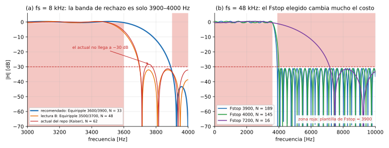

# TP2 – Análisis de diseño del filtro FIR pasa bajos

- **Consigna:** pasa bajos.
- **Fc = 3600 Hz**, **Astop = 30 dB**.
- FIR procesado por muestras.
- Para fs = 8, 16, 22, 44 y 48 kHz, en la FRDM-MCXN947 (Cortex-M33 a 150 MHz) con CMSIS-DSP en Q15.

Este documento sigue el mismo esquema que [`analisis-filtro-pasa-altos.md`](analisis-filtro-pasa-altos.md): las formas de diseñar el filtro con `filterDesigner`, la comparación con números y un veredicto con los parámetros para cargar en la herramienta. La teoría de cada concepto está en [`teoria-tp2-filtros-fir.md`](teoria-tp2-filtros-fir.md).

---

## 0. Resumen y veredicto

| | Recomendación |
|---|---|
| Interpretación de "Fc = 3600 Hz" | **Borde de la banda de paso** (Fpass = 3600 Hz): a 3600 Hz la señal pasa casi intacta (−0,5 dB) |
| Método en `filterDesigner` | **FIR → Equiripple**, **Minimum order** |
| Especificaciones | **Fpass = 3600 Hz, Fstop = 3900 Hz, Apass = 1 dB, Astop = 31 dB**, iguales para las 5 fs |
| Orden / taps resultantes | 8k: 33 (34 taps) · 16k: 63 (64) · 22k: 87 (88) · 44k: 173 (174) · 48k: 189 (190) |
| Comparado con el diseño actual del repo | El actual (Kaiser, 3500/3700 Hz) usa 64…370 taps; el recomendado usa **≈ 48 % menos** |
| Retardo de grupo | ≈ 2 ms en todas las fs (actual: ≈ 3,9 ms) |
| Tiempo real con `arm_fir_q15` | **Entra en las 5 fs** (carga estimada: 3 % a 8 kHz, 61 % a 48 kHz) |

**Diferencias con el pasa altos:**

- **El pasa bajos es barato.** La transición puede ser de cientos de Hz, contra los 30 Hz del pasa altos, y el orden es proporcional a fs/Δf. Por eso entra en tiempo real en todas las fs.
- **A 8 kHz casi no hay banda de rechazo.** Nyquist está en 4000 Hz, así que la zona por encima de 3600 Hz tiene solo 400 Hz. El filtro hace muy poco a esa fs, y el DAC por sí solo ya atenúa 3,1 dB a 3600 Hz (§9).
- **El pasa bajos actual del repo no cumple a 8 kHz:** llega a −28,3 dB en la banda de rechazo, no a −30 dB (§3).

---

## 1. Qué dice la consigna y qué deja abierto

| Parámetro | ¿Lo da la consigna? | Qué decidimos |
|---|---|---|
| Fs | Sí (5 valores) | Un diseño por cada fs |
| Fpass | Indirectamente (Fc) | 3600 Hz |
| Fstop | **No** | Decisión de diseño (§5): 3900 Hz |
| Apass | **No** | 1 dB (valor por defecto de la herramienta) |
| Astop | Sí: 30 dB | 31 dB (margen para Q15, §7) |
| Método y orden | **No** | Equiripple, orden mínimo |

### 1.1 Tres maneras de leer "Fc = 3600 Hz"

| Interpretación | Qué significa | Ganancia a 3600 Hz | Orden a 8 kHz* |
|---|---|---|---|
| **A. Fc = Fpass** (recomendada) | hasta 3600 Hz la señal pasa con ≤ 1 dB de error | −0,5 dB | **31** (Fstop 3900) |
| B. Fc = punto de −6 dB | es lo que hizo el diseño actual del repo: Fpass = 3500, Fstop = 3700, con el corte en el medio | −6 dB | 48 |
| C. Fc = punto de −3 dB | equivale a Equiripple con Apass = 3 dB | −1,6 dB | 23 (Fstop 3900) |

\* Equiripple, Astop = 30 dB.

Como en el pasa altos, la **A** es la más estricta: a 3600 Hz la señal pasa. Con un Fstop razonable también es de las más baratas. La B atenúa a la mitad justo en la frecuencia que da la consigna. La C obliga a tener ±1,5 dB de ripple en toda la banda de paso.

> En el informe hay que escribir qué interpretación se usó. Ojo: el pasa bajos del repo usa la B y el pasa altos la A, así que hoy los dos filtros no son coherentes entre sí.

---

## 2. Cómo se carga en `filterDesigner`

Es igual que el pasa altos (sección 2 de su análisis), con dos diferencias:

- **Response Type: Lowpass.**
- **El orden puede ser impar.** Un pasa bajos puede ser tipo II (orden impar), porque el cero que ese tipo tiene en Nyquist está en la banda de rechazo: no molesta, ayuda. Con orden impar, la cantidad de coeficientes N + 1 ya es par, así que **no hace falta agregar el cero de relleno** para CMSIS. Por ejemplo, N = 33 da 34 taps.

---

## 3. Cómo se hizo este análisis

Con las mismas técnicas que el del pasa altos, ahora con scipy:

- Equiripple con `remez`, que es Parks-McClellan;
- mínimos cuadrados con `firls`;
- ventanas con `firwin`;
- `kaiserord` con la fórmula de MATLAB.

Cada diseño se verificó con su respuesta en frecuencia real, antes y después de cuantizar a Q15. El orden mínimo se buscó subiendo y bajando N hasta el primero que cumple.

**Validación contra el repo:** con Kaiser, Fpass = 3500, Fstop = 3700, Apass = 1 y Astop = 30, `kaiserord` da exactamente **64 / 124 / 170 / 340 / 370 taps**, los mismos de `PB_8k` … `PB_48k` en `filtros.h`. O sea, así se diseñó el pasa bajos actual.

**El diseño actual no cumple a 8 kHz.** Midiendo la respuesta de los coeficientes Q15 que están en `filtros.h`:

| fs | Peor atenuación en la banda de rechazo (≥ 3700 Hz) | ¿Cumple 30 dB? |
|---|---|---|
| 8 kHz | **−28,3 dB** | **no** |
| 16 kHz | −30,2 dB | sí, justo |
| 22 kHz | −30,2 dB | sí, justo |
| 44 kHz | −30,2 dB | sí, justo |
| 48 kHz | −30,1 dB | sí, justo |

Pasa porque `kaiserord` subestima el orden (da 62 y hacen falta 65) y porque la cuantización a Q15 resta unas décimas más. Es el mismo problema que se vio en el pasa altos.

---

## 4. Comparación de métodos (fs = 8 kHz)

Orden mínimo N que cumple la especificación (Apass = 1 dB, Astop = 30 dB), verificado con la respuesta real. Taps en CMSIS = N + 1, más 1 si queda impar.

| Especificación | Equiripple | Least-squares | Kaiser (`kaiserord`) | Kaiser (real) | Chebyshev 30 dB | Hamming | Hann | Blackman |
|---|---|---|---|---|---|---|---|---|
| Fpass 3500 / Fstop 3700 (B, Δf = 200) | **48** | 72 | 62 ✗ | 65 | 76 | 102 | 106 | 134 |
| Fpass 3600 / Fstop 3900 (A, Δf = 300) | **31** | 48 | 41 ✓ | 41 | 51 | 68 | 71 | 90 |

- ✗ = el orden que propone `kaiserord` **no cumple**. Es el caso del repo.
- **Equiripple vuelve a ser el de menor orden:** ≈ 25 % menos que Kaiser y menos de la mitad que Hamming, Hann o Blackman.
- **La ventana rectangular "cumple" acá** (N = 183 para la B y 80 para la A), y Bartlett también para la A (N = 91). En el pasa altos no pasaba. No es mérito de esas ventanas: a 8 kHz la banda de rechazo es tan angosta (3700–4000 o 3900–4000 Hz) que el primer lóbulo lateral grande cae casi fuera de ella. Igual son de las peores opciones en cantidad de coeficientes.

---

## 5. La decisión que más pesa: Fstop

Como en el pasa altos, el costo lo domina el ancho de la transición Δf = Fstop − Fpass. Equiripple, 8 kHz, Fpass = 3600 Hz:

| Fstop | 3700 | 3800 | **3900** | 3950 |
|---|---|---|---|---|
| Δf | 100 Hz | 200 Hz | **300 Hz** | 350 Hz |
| Orden | 96 | 49 | **31** | 26 |

**¿Por qué Fstop = 3900 Hz?**

- **A 8 kHz no se puede ir mucho más allá:** Nyquist es 4000 Hz, y con Fstop = 3900 la banda de rechazo ya es de solo 100 Hz.
- **Usar el mismo Fstop en las 5 fs** hace que el filtro se comporte igual en Hz en todas, y eso permite comparar las mediciones del osciloscopio entre una fs y otra.
- **Es barato en todas las fs** (§8).

### 5.1 Efecto de Apass y Astop (8 kHz, Fpass 3600, Fstop 3900)

| Apass | 0,1 dB | 0,5 dB | **1 dB** | 2 dB | 3 dB |
|---|---|---|---|---|---|
| Orden | 49 | 37 | **31** | 27 | 23 |

| Astop | 30 dB | **31 dB** | 33 dB | 40 dB | 50 dB |
|---|---|---|---|---|---|
| Orden | 31 | **33** | 35 | 39 | 44 |

Es el mismo patrón que en el pasa altos: **subir Astop es barato** (+10 dB cuesta ~25 % más) y bajar Apass encarece más.

---

## 6. Todas las frecuencias de muestreo

Orden N (y taps en CMSIS). Todos los Equiripple con Apass = 1 dB y Astop = 31 dB.

| Diseño | 8 kHz | 16 kHz | 22 kHz | 44 kHz | 48 kHz |
|---|---|---|---|---|---|
| **Equiripple, Fpass 3600, Fstop 3900 (recomendado)** | **33 (34)** | **63 (64)** | **87 (88)** | **173 (174)** | **189 (190)** |
| Equiripple, Fpass 3600, Fstop 4000 | — (Nyquist) | 49 (50) | 67 (68) | 133 (134) | 145 (146) |
| Equiripple, Fpass 3600, Fstop 7200 | — (Nyquist) | 6 (8) | 7 (8) | 15 (16) | 16 (18) |
| Equiripple, lectura B (3500 / 3700) | 48 (50) | 96 (98) | 131 (132) | 262 (264) | 286 (288) |
| Kaiser `kaiserord` 3500 / 3700 (**diseño actual del repo**) | 62 (64) | 123 (124) | 169 (170) | 338 (340) | 369 (370) |

- **El orden es proporcional a fs** cuando la especificación en Hz es la misma, igual que en el pasa altos.
- **Retardo de grupo:** ≈ 2 ms el recomendado y ≈ 3 ms la lectura B, en todas las fs.

**La fila de Fstop = 7200 Hz muestra un caso extremo:** con fs alta se puede ensanchar mucho la transición y el filtro queda casi gratis (8 a 18 taps). El costo es que entre 3600 y 7200 Hz la atenuación es gradual. Sirve si lo que importa es solo "pasar hasta 3600 y rechazar lo que esté bastante más arriba". Es una lectura válida de la consigna, pero el filtro se comporta distinto en cada fs.



*Las zonas rojas son la plantilla del diseño recomendado (Fpass 3600, Fstop 3900, Astop 30). (a) A 8 kHz: el recomendado, la lectura B y el diseño actual del repo, que en 3740–3780 Hz sube por encima de −30 dB. (b) A 48 kHz: el mismo Fpass con tres Fstop distintos. Con 7200 Hz alcanzan 16 coeficientes, pero la caída es lenta.*

---

## 7. Cuantización a Q15

Todos los diseños recomendados cumplen después de redondear a Q15:

| fs | Rechazo (Q15) | Banda de paso (Q15) |
|---|---|---|
| 8 kHz | −33,4 dB | −0,39 … +0,37 dB |
| 16 kHz | −31,2 dB | −0,50 … +0,47 dB |
| 22 kHz | −31,2 dB | −0,50 … +0,47 dB |
| 44 kHz | −31,0 dB | −0,51 … +0,48 dB |
| 48 kHz | −31,0 dB | −0,51 … +0,48 dB |

El margen de 1 dB en Astop alcanza: el peor caso queda en −31,0 dB, contra los −30 dB que pide la consigna. Al ser filtros cortos, ningún coeficiente se redondea a cero.

---

## 8. ¿Entra en tiempo real?

Mismo modelo de costo que en el pasa altos: ≈ 9 ciclos por coeficiente con `arm_fir_q15` y `BLOCK_SIZE 1`, más ≈ 200 ciclos fijos de la ISR. **Es una estimación: hay que medirlo.**

| Opción | 8k | 16k | 22k | 44k | 48k |
|---|---|---|---|---|---|
| Actual del repo (Kaiser 3500/3700) | 4 % | 14 % | 25 % | 96 % ⚠ | **113 %** ✗ |
| Equiripple lectura B (3500/3700) | 3,5 % | 12 % | 20 % | 76 % | 89 % ⚠ |
| **Equiripple 3600/3900 (recomendado)** | **2,7 %** | **8 %** | **15 %** | **52 %** | **61 %** |
| Equiripple 3600/4000 | — | 7 % | 12 % | 41 % | 48 % |
| Equiripple 3600/7200 | — | 3 % | 4 % | 10 % | 12 % |

- **El recomendado entra en las 5 fs** con margen.
- **El pasa bajos actual del repo probablemente no entra a 48 kHz.**

---

## 9. Particularidades del pasa bajos

### 9.1 A 8 kHz, el DAC ya atenúa la banda de interés

La retención de orden cero del DAC atenúa las frecuencias altas (sección 3.4 de la teoría):

| fs | Atenuación del DAC a 3500 Hz | a 3600 Hz |
|---|---|---|
| 8 kHz | −2,9 dB | **−3,1 dB** |
| 16 kHz | −0,7 dB | −0,7 dB |
| 22 kHz | −0,4 dB | −0,4 dB |
| 44 kHz | −0,1 dB | −0,1 dB |
| 48 kHz | −0,1 dB | −0,1 dB |

A 8 kHz, una senoidal de 3600 Hz sale 3,1 dB más chica **aunque el filtro esté en BYPASS**. Si medís el pasa bajos sin comparar contra BYPASS, vas a atribuirle al filtro una atenuación que es del DAC.

**Al medir, siempre calculá la ganancia como `20·log10(Vpp_filtro / Vpp_bypass)`.**

### 9.2 Un pasa bajos digital no es un filtro antialiasing

Si a fs = 8 kHz entra una senoidal de 5 kHz, el ADC la convierte en 3 kHz (aliasing, sección 2.3 de la teoría). El pasa bajos de 3600 Hz la deja pasar, porque para él **es** una senoidal de 3 kHz. El pasa bajos solo actúa sobre lo que ya está entre 0 y fs/2.

### 9.3 A 8 kHz el filtro hace muy poco

Entre 0 y 4000 Hz, el filtro deja pasar de 0 a 3600 y rechaza solo de 3900 a 4000. Si la señal de prueba no tiene contenido en ese último tramo, a 8 kHz **no se nota diferencia** entre BYPASS y pasa bajos. Para ver el filtro a 8 kHz hace falta una senoidal entre 3900 y 4000 Hz.

A 16 kHz o más, en cambio, se ve claramente: una senoidal de 5 kHz pasa en BYPASS y desaparece con el filtro.

---

## 10. Contraste con IIR

Órdenes IIR para la misma especificación a 8 kHz (`buttord`, `cheb1ord`, `ellipord`):

| Especificación | Butterworth | Chebyshev I | Elíptico | FIR Equiripple |
|---|---|---|---|---|
| 3600 / 3900 Hz | 3 | 3 | 2 | 33 |
| 3500 / 3700 Hz | 8 | 5 | 4 | 48 |

La diferencia es menor que en el pasa altos (orden 3 contra 260), porque acá el FIR ya es corto.

---

## 11. Qué esperar en el osciloscopio (2 Vpp, diseño recomendado)

| Frecuencia | Zona | Ganancia del filtro | Vpp esperado (relativo a BYPASS) |
|---|---|---|---|
| 100 Hz … 3500 Hz | paso | −0,5 … +0,5 dB | 1,89 … 2,11 Vpp |
| 3600 Hz | borde de paso | ≈ −0,5 dB | ≈ 1,89 Vpp |
| 3700 … 3850 Hz | transición | entre −0,5 y −31 dB | baja rápido |
| de 3900 Hz a fs/2 | rechazo | ≤ −31 dB | ≤ 56 mVpp |

**Retardo de grupo:** ≈ 2 ms en todas las fs. Es mucho menor que el del pasa altos (16 ms), porque el filtro es más corto.

---

## 12. Abanico de opciones

| # | Opción | Taps 8k / 48k | ¿Cumple la consigna? | Tiempo real (`arm_fir_q15`) | Comentario |
|---|---|---|---|---|---|
| 1 | **Equiripple 3600/3900, Astop 31** | 34 / 190 | Sí (lectura A) | las 5 fs ✓ | **Recomendada**: igual en Hz en todas las fs |
| 2 | Equiripple 3600/4000 (fs ≥ 16k) + opción 1 a 8k | 34 / 146 | Sí | las 5 fs ✓ | 25 % menos taps a fs alta, pero el Fstop cambia entre 8k y el resto |
| 3 | Equiripple 3600/7200 (fs ≥ 16k) | 34 / 18 | Sí, con transición muy ancha | las 5 fs ✓ | Casi gratis; atenúa poco entre 3600 y 7200 Hz |
| 4 | Equiripple lectura B (3500/3700) | 50 / 288 | Discutible: a 3600 Hz atenúa 6 dB | 48k ⚠ (89 %) | Igual que el repo, pero bien dimensionado |
| 5 | Kaiser `kaiserord` 3500/3700 (actual) | 64 / 370 | **No a 8 kHz** (−28,3 dB) | 44k ⚠, 48k ✗ | Hay que subir el orden a mano |
| 6 | Least-squares / Chebyshev / Hamming… | 1,5–3× la opción 1 | Sí | peor que la 1 | Sin ventajas |
| 7 | Lectura C (−3 dB en 3600) | 24 / — | Discutible | ✓ | Obliga a ±1,5 dB de ripple en toda la banda de paso |

## 13. Veredicto

1. **Opción 1:** `filterDesigner` → Lowpass → FIR **Equiripple** → **Minimum order** → Units Hz, **Fs** = cada una, **Fpass = 3600**, **Fstop = 3900** → Units dB, **Apass = 1**, **Astop = 31**. Repetir para las 5 fs.
   - Es el método de menor orden: ≈ 25 % menos que Kaiser con la misma especificación y ≈ 48 % menos que el diseño actual.
   - Cumple la consigna después de Q15 en todas las fs.
   - Entra en tiempo real en todas las fs.
2. **Coherencia con el pasa altos:** con la lectura A en los dos filtros, "Fc" significa lo mismo en toda la consigna (borde de la banda de paso), y en el informe se justifica una sola vez.
3. **Medir contra BYPASS**, sobre todo a 8 kHz (caída del DAC de 3,1 dB a 3600 Hz).

### Pasos en `filterDesigner`

1. Response Type: **Lowpass**. Design Method: **FIR → Equiripple**. Filter Order: **Minimum order**.
2. Frequency Specifications: Units **Hz**, Fs **8000**, Fpass **3600**, Fstop **3900**.
3. Magnitude Specifications: Units **dB**, Apass **1**, Astop **31**. → **Design Filter**. Anotar el orden (≈ 33).
4. **Set quantization parameters** → Fixed-point, numerador de 16 bits con 15 fraccionarios. Verificar que la respuesta cuantizada siga por debajo de −30 dB desde 3900 Hz.
5. Exportar y regenerar `filtros.h`. Si el orden es impar, la cantidad de coeficientes ya es par y no hace falta el cero de relleno.
6. Repetir con Fs = 16000, 22000, 44000 y 48000.

Por comandos (MATLAB, Signal Processing Toolbox):

```matlab
fs = 8000;   % repetir con 16000, 22000, 44000, 48000
d = designfilt('lowpassfir', 'PassbandFrequency', 3600, 'StopbandFrequency', 3900, ...
               'PassbandRipple', 1, 'StopbandAttenuation', 31, ...
               'SampleRate', fs, 'DesignMethod', 'equiripple');
h = d.Coefficients;  numel(h) - 1   % orden (≈ 33 a 8 kHz)
```
