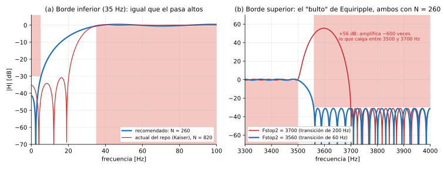

# TP2 – Análisis de diseño del filtro FIR pasa banda

- **Consigna:** pasa banda.
- **Fc1 = 35 Hz**, **Fc2 = 3500 Hz**, **Astop = 30 dB**.
- FIR procesado por muestras.
- Para fs = 8, 16, 22, 44 y 48 kHz, en la FRDM-MCXN947 (Cortex-M33 a 150 MHz) con CMSIS-DSP en Q15.

Este documento sigue el mismo esquema que [`analisis-filtro-pasa-altos.md`](analisis-filtro-pasa-altos.md) y [`analisis-filtro-pasa-bajos.md`](analisis-filtro-pasa-bajos.md). La teoría está en [`teoria-tp2-filtros-fir.md`](teoria-tp2-filtros-fir.md).

---

## 0. Resumen y veredicto

| | Recomendación |
|---|---|
| Interpretación de Fc1 y Fc2 | **Bordes de la banda de paso** (Fpass1 = 35 Hz, Fpass2 = 3500 Hz), igual que en el pasa altos y el pasa bajos |
| Método en `filterDesigner` | **FIR → Equiripple**, **Minimum order** |
| Especificaciones | **Fstop1 = 5 Hz, Fpass1 = 35 Hz, Fpass2 = 3500 Hz, Fstop2 = 3560 Hz, Apass = 1 dB, Astop1 = Astop2 = 31 dB** |
| Orden / taps resultantes | 8k: 260 (262 taps) · 16k: 520 (522) · 22k: 714 (716) · 44k: ≈ 1430 (≈ 1432) · 48k: ≈ 1560 (≈ 1562) |
| Comparado con el diseño actual del repo | El actual (Kaiser) usa 822…4916 taps; el recomendado usa **≈ 68 % menos** |
| Retardo de grupo | ≈ 16 ms en todas las fs (actual: ≈ 51 ms) |
| Tiempo real con `arm_fir_q15` | Entra a 8 y 16 kHz, queda al límite a 22 kHz y no entra a 44/48 kHz. Es lo mismo que el pasa altos |

**Las dos ideas clave de este filtro:**

1. **El pasa banda cuesta lo mismo que el pasa altos.** El borde de 35 Hz es el caro, igual que en el pasa altos. El de 3500 Hz es barato y, diseñado bien, no agrega coeficientes. Todo lo que se dijo del pasa altos (Fstop1 = 5 Hz, Equiripple, límite de tiempo real) vale acá.
2. **Cuidado con el "bulto" de Equiripple.** Si la transición superior se hace mucho más ancha que la inferior (por ejemplo, 3500 → 3700 Hz, como en el repo), el diseño Equiripple de orden mínimo cumple la plantilla pero **amplifica más de 50 dB** dentro de esa transición (§5). Hay que elegir Fstop2 cerca de Fpass2: **Fstop2 = 3560 Hz**.

---

## 1. Qué dice la consigna y qué deja abierto

| Parámetro | ¿Lo da la consigna? | Qué decidimos |
|---|---|---|
| Fs | Sí (5 valores) | Un diseño por cada fs |
| Fpass1, Fpass2 | Indirectamente (Fc1, Fc2) | 35 Hz y 3500 Hz |
| Fstop1 | **No** | 5 Hz, igual que el pasa altos (§4) |
| Fstop2 | **No** | 3560 Hz, para evitar el bulto (§5) |
| Apass | **No** | 1 dB |
| Astop1, Astop2 | Sí: 30 dB | 31 dB en las dos bandas de rechazo (margen Q15) |
| Método y orden | **No** | Equiripple, orden mínimo |

Las interpretaciones de "Fc" son las mismas que en el pasa altos: borde de paso, −3 dB o −6 dB. Se usa la del borde de paso para que las cuatro especificaciones de la consigna se lean igual.

**El diseño actual del repo** se reproduce con `kaiserord` usando Fstop1 = 20, Fpass1 = 35, Fpass2 = 3500, Fstop2 = 3700, Apass = 1, Astop = 30. Da exactamente 822 / 1640 / 2254 / 4508 / 4916 taps.

Kaiser usa la transición más angosta (15 Hz) para los dos bordes. Por eso el corte de arriba del filtro actual quedó en 3593–3607 Hz (−0,5 a −30 dB): mucho más abrupto de lo especificado y con el −6 dB en 3600 Hz. Medido con los coeficientes Q15, **cumple los 30 dB en todas las fs**: el peor caso es −30,8 dB.

---

## 2. Cómo se carga en `filterDesigner`

- **Response Type: Bandpass.**
- Frequency Specifications: **Fstop1, Fpass1, Fpass2, Fstop2**.
- Magnitude Specifications: **Astop1, Apass, Astop2**. Ponemos las dos atenuaciones iguales.
- El orden puede salir par o impar. Un pasa banda puede ser tipo II, porque su cero en Nyquist cae en la banda de rechazo. Si sale impar, no hace falta el cero de relleno para CMSIS.

---

## 3. Cómo se hizo este análisis

Igual que el del pasa bajos: Equiripple con `remez` de scipy, mínimos cuadrados con `firls`, ventanas con `firwin` y `kaiserord` con la fórmula de MATLAB. Se buscó el orden mínimo verificando la respuesta real, antes y después de Q15.

Se agregó una verificación que en el pasa altos no hacía falta: **la ganancia dentro de las transiciones no puede superar la máxima de la banda de paso.** Con una sola transición (pasa altos, pasa bajos) nunca pasa. Con dos transiciones de anchos muy distintos, sí (§5).

A 44 y 48 kHz, `remez` no converge bien. Esos valores salen de escalar con fs (verificado a 8, 16 y 22 kHz: 260 → 520 → 714) y van marcados con "≈".

---

## 4. Borde inferior (35 Hz): es el que fija el costo

### 4.1 Comparación de métodos (fs = 8 kHz)

Las dos transiciones con el mismo ancho, que es lo que hace el método de ventanas:

| Especificación | Equiripple | Least-squares | Kaiser (`kaiserord`) | Kaiser (real) | Chebyshev 30 dB | Hamming | Hann | Blackman |
|---|---|---|---|---|---|---|---|---|
| Fstop1 20 / Fstop2 3515 (Δf = 15) | **647** | 1024 | 820 ✓ | 820 | 1031 | 1352 | 1403 | 1779 |
| Fstop1 5 / Fstop2 3530 (Δf = 30) | **307** | 512 | 410 ✗ | 602 | 513 | 673 | 702 | 891 |
| Fstop1 5 / Fstop2 3560 (Δf = 30 y 60) | **260** | — | — | — | — | — | — | — |

- **Son prácticamente los números del pasa altos** (648 / 994 / 820 / 804 / 1028 / 1352 / 1404 / 1780 con Fstop 20). El borde de 3500 Hz no agrega nada cuando está bien elegido.
- Rectangular y Bartlett no llegan a 30 dB, como en el pasa altos.
- La última fila es la recomendada. Con Equiripple, dejar la transición de arriba un poco más ancha que la de abajo baja de 307 a 260 (§5).

### 4.2 Fstop1 (Equiripple, 8 kHz, Fstop2 al doble de distancia)

| Fstop1 | 20 Hz | 10 Hz | **5 Hz** |
|---|---|---|---|
| Orden pasa banda | 652 | 429 | **260** |
| Orden pasa altos (referencia) | 652 | 428 | 260 |

Por eso se elige **Fstop1 = 5 Hz**, por las mismas razones que en el pasa altos: rechazo garantizado de la continua y de la deriva lenta, y la transición más ancha posible.

### 4.3 Apass (8 kHz, Fstop1 5 / Fstop2 3530)

| Apass | 0,5 dB | **1 dB** | 2 dB |
|---|---|---|---|
| Orden | 356 | **307** | 255 |

---

## 5. Borde superior (3500 Hz): el "bulto" de Equiripple

### 5.1 Qué pasa

Equiripple solo controla la respuesta **dentro de las bandas especificadas**. En las transiciones no hay ninguna restricción. Si una transición es mucho más ancha de lo que el filtro necesita, el algoritmo puede "usarla" para mejorar el error en las bandas, y la respuesta ahí adentro sube sin límite.

Ejemplo con N = 260 a 8 kHz, todo igual salvo Fstop2:

| Fstop2 | Ancho de la transición superior | ¿Cumple la plantilla? | Ganancia máxima en la transición |
|---|---|---|---|
| 3530 | 30 Hz | sí (necesita N = 307) | −0,5 dB ✓ |
| 3540 … 3570 | 40 … 70 Hz | sí, con N = 260 | −0,5 dB ✓ |
| 3580 | 80 Hz | sí, con N = 260 | 0 dB (límite) |
| 3590 | 90 Hz | sí, con N = 260 | **+7 dB** ✗ |
| 3600 | 100 Hz | sí, con N = 260 | **+9 dB** ✗ |
| 3700 (como el repo) | 200 Hz | sí, con N = 260 | **+56 dB** ✗ |

Con Fstop2 = 3700, una senoidal de 3600 Hz sale **amplificada ~600 veces** y satura. Con el analizador de `filterDesigner` se ve en la respuesta en magnitud, si se mira toda la banda y no solo la plantilla.



*(a) El borde de 35 Hz: el recomendado (N = 260) frente al actual del repo (N = 820). (b) El borde de 3500 Hz con N = 260: con la transición de 200 Hz aparece un pico de +56 dB. Con 60 Hz, la respuesta cae limpia.*

### 5.2 Regla práctica

**En un Equiripple con varias transiciones, ninguna transición debería ser más que ~2–2,5 veces más ancha que la más angosta.** Acá, con 30 Hz abajo, la de arriba puede llegar hasta ~70 Hz: **Fstop2 = 3560 Hz** (60 Hz).

**No cuesta nada:** el orden lo fija la transición angosta, y una transición superior de 60 Hz da el mismo N = 260 que una de 200 Hz.

Este problema no aparece con las ventanas (Kaiser, Hamming…), porque fuerzan el mismo ancho en las dos transiciones.

---

## 6. Todas las frecuencias de muestreo

Orden N (y taps en CMSIS). Equiripple con Apass = 1 dB y Astop = 31 dB, transición superior ≈ 2× la inferior.

| Diseño | 8 kHz | 16 kHz | 22 kHz | 44 kHz | 48 kHz |
|---|---|---|---|---|---|
| **Fstop1 5, Fstop2 3560 (recomendado)** | **260 (262)** | **520 (522)** | **714 (716)** | **≈ 1430 (≈ 1432)** | **≈ 1560 (≈ 1562)** |
| Fstop1 10, Fstop2 3550 | 429 (430) | 859 (860) | ≈ 1180 | ≈ 2360 | ≈ 2575 |
| Fstop1 20, Fstop2 3530 | 652 (654) | 1304 (1306) | ≈ 1793 | ≈ 3586 | ≈ 3912 |
| Kaiser `kaiserord` 20/3700 (**diseño actual del repo**) | 820 (822) | 1639 (1640) | 2253 (2254) | 4506 (4508) | 4915 (4916) |

**Retardo de grupo:** N / (2·fs) ≈ 16 ms en todas las fs para el recomendado, y ≈ 51 ms para el actual.

---

## 7. Cuantización a Q15

| fs | Rechazo (Q15) | Banda de paso (Q15) |
|---|---|---|
| 8 kHz | −31,1 dB | −0,51 … +0,48 dB |
| 16 kHz | −30,95 dB | −0,51 … +0,48 dB |
| 22 kHz | −30,9 dB | −0,52 … +0,49 dB |

- **El rechazo cumple los 30 dB** de la consigna con margen.
- **La banda de paso se corre unas centésimas de dB** por fuera de ±0,5 dB (−0,52 contra un límite de −0,514). Es el mismo efecto que en el pasa altos y no importa en la práctica. Para cumplirlo al pie de la letra, usar **Apass = 0,9 dB** (+3 % de coeficientes).

---

## 8. ¿Entra en tiempo real?

Mismo modelo de costo: ≈ 9 ciclos por coeficiente con `arm_fir_q15` y `BLOCK_SIZE 1`, más ≈ 200 ciclos de la ISR. **Es una estimación.**

| Opción | 8k | 16k | 22k | 44k | 48k |
|---|---|---|---|---|---|
| Actual del repo (Kaiser) | 41 % | **160 %** ✗ | 300 % ✗ | 1200 % ✗ | 1420 % ✗ |
| Equiripple Fstop1 20 | 33 % | 128 % ✗ | 240 % ✗ | — | — |
| Equiripple Fstop1 10 | 22 % | 85 % ⚠ | 159 % ✗ | — | — |
| **Equiripple Fstop1 5 (recomendado)** | **14 %** | **52 %** | **97 %** ⚠ | **384 %** ✗ | **456 %** ✗ |

Es la misma conclusión que en el pasa altos:

- `arm_fir_q15` alcanza a 8 y 16 kHz y queda al límite a 22 kHz.
- **El pasa banda actual del repo probablemente ya no entra a 16 kHz.**
- Para 44/48 kHz valen las mismas alternativas que en el pasa altos: un FIR propio que aproveche la simetría (§9 del análisis del pasa altos), o documentar el límite midiendo los ciclos.

**¿Y hacerlo como pasa altos + pasa bajos en cascada?** El pasa altos recomendado (262 taps) más un pasa bajos 3500/3800 Hz (≈ 34 taps) suman ≈ 296 taps a 8 kHz, contra 262 del filtro único. Un solo filtro pasa banda es más barato, porque el borde de 3500 Hz "viaja gratis" dentro del orden que ya exige el borde de 35 Hz.

---

## 9. Qué esperar en el osciloscopio (2 Vpp, diseño recomendado)

| Frecuencia | Zona | Ganancia | Vpp esperado (relativo a BYPASS) |
|---|---|---|---|
| continua, 1 … 5 Hz | rechazo inferior | ≤ −31 dB | ≤ 56 mVpp, salida centrada en 2048 |
| 10 … 30 Hz | transición | entre −31 y −0,5 dB | sube |
| 35 Hz … 3500 Hz | paso | −0,5 … +0,5 dB | 1,89 … 2,11 Vpp |
| 3500 … 3560 Hz | transición | baja sin sobrepicos | baja |
| 3560 Hz … fs/2 | rechazo superior | ≤ −31 dB | ≤ 56 mVpp |

**Retardo:** ≈ 16 ms, igual que el pasa altos.

A 8 kHz, recordá la caída del DAC cerca de 3500 Hz (−2,9 dB, sección 9.1 del análisis del pasa bajos). **Siempre hay que medir contra BYPASS.**

---

## 10. Contraste con IIR

A 8 kHz, la misma especificación (5/35/3500/3800 Hz, 1 dB, 30 dB) se cumple con un IIR Butterworth de orden 5, un Chebyshev I de orden 4 o un elíptico de orden 3. El FIR necesita 260. Es la misma relación que en el pasa altos: lo caro es el borde de 35 Hz.

---

## 11. Abanico de opciones

| # | Opción | Taps 8k / 48k | ¿Cumple la consigna? | Tiempo real (`arm_fir_q15`) | Comentario |
|---|---|---|---|---|---|
| 1 | **Equiripple 5/35/3500/3560, Astop 31** | 262 / ≈ 1562 | Sí | 8k ✓ 16k ✓ 22k ⚠ 44/48k ✗ | **Recomendada** |
| 2 | Equiripple 10/35/3500/3550 | 430 / ≈ 2576 | Sí | 8k ✓ 16k ⚠ resto ✗ | Si se pide una banda de rechazo inferior más ancha |
| 3 | Equiripple 20/35/3500/3530 | 654 / ≈ 3914 | Sí | 8k ✓ resto ✗ | Transición angosta, cara |
| 4 | Equiripple con transición superior ancha (3700) | 262 / — | Cumple la plantilla, pero **amplifica +56 dB** en 3500–3700 Hz | — | **Descartada** |
| 5 | Kaiser `kaiserord` 20/35/3500/3700 (actual) | 822 / 4916 | Sí | 8k ✓ resto ✗ | Es lo que está hoy en `filtros.h` |
| 6 | Pasa altos + pasa bajos en cascada | 296 / ≈ 1752 | Sí | peor que la 1 | Dos filtros, más taps |
| 7 | Least-squares / Chebyshev / Hamming… | 1,7–3,4× la opción 1 | Sí | peor que la 1 | Sin ventajas |

## 12. Veredicto

1. **Opción 1:** `filterDesigner` → Bandpass → FIR **Equiripple** → **Minimum order** → Units Hz, **Fs** = cada una, **Fstop1 = 5**, **Fpass1 = 35**, **Fpass2 = 3500**, **Fstop2 = 3560** → Units dB, **Astop1 = 31**, **Apass = 1**, **Astop2 = 31**. Repetir para las 5 fs.
   - Usa ≈ 68 % menos coeficientes que el diseño actual y cuesta lo mismo que el pasa altos.
2. **Revisar siempre toda la respuesta** en `filterDesigner`, no solo la plantilla. Si aparece un pico en alguna transición, hay que acercar el Fstop de esa transición.
3. **Tiempo real:** las mismas conclusiones que en el pasa altos (8 y 16 kHz ✓, 22 kHz al límite, 44/48 kHz ✗ con `arm_fir_q15`). Hay que medirlo con el contador DWT.

### Por comandos (MATLAB)

```matlab
fs = 8000;   % repetir con 16000, 22000, 44000, 48000
d = designfilt('bandpassfir', ...
    'StopbandFrequency1', 5,    'PassbandFrequency1', 35, ...
    'PassbandFrequency2', 3500, 'StopbandFrequency2', 3560, ...
    'StopbandAttenuation1', 31, 'PassbandRipple', 1, 'StopbandAttenuation2', 31, ...
    'SampleRate', fs, 'DesignMethod', 'equiripple');
h = d.Coefficients;  numel(h) - 1   % orden (≈ 260 a 8 kHz)
fvtool(d)                           % mirar TODA la respuesta: que no haya picos en las transiciones
```
