# TP2 – Teoría necesaria: señales, muestreo y filtros FIR

Este apunte reúne la teoría que hay que tener clara para hacer y defender el TP2: filtros FIR por muestras en la FRDM-MCXN947, diseñados con `filterDesigner` (ex `fdatool`) e implementados con CMSIS-DSP en Q15.

Está ordenado como una clase: primero las herramientas (decibeles), después la señal, el sistema, la especificación, el diseño y por último la implementación y la medición. Cada tema sigue el mismo esquema:

1. **Qué es.**
2. **Cómo se lee.** Qué significa cada número.
3. **Ejemplo con números del TP.** Las cuentas hechas paso a paso.
4. **Por qué importa en el TP.**

Los ejemplos usan el **pasa altos** de la consigna (Fc = 35 Hz, Astop = 30 dB). El análisis de diseño completo está en [`analisis-filtro-pasa-altos.md`](analisis-filtro-pasa-altos.md).

Las figuras están en [`figuras/`](figuras/) y se calculan con los filtros reales (scipy) mediante [`figuras/generar_figuras.py`](figuras/generar_figuras.py). Los diagramas de bloques están en Mermaid: GitHub los dibuja solo, y en VS Code hace falta la extensión *Markdown Preview Mermaid Support*.

**Notación**

| Símbolo | Qué es | Unidad |
|---|---|---|
| $f$ | frecuencia de una señal analógica | Hz |
| $f_s$ | frecuencia de muestreo (8, 16, 22, 44 o 48 kHz) | Hz |
| $T_s = 1/f_s$ | tiempo entre dos muestras | s |
| $n$ | número de muestra (0, 1, 2, …) | — |
| $\omega$ | frecuencia digital | rad/muestra |
| $h[k]$ | coeficientes del filtro FIR | — |
| $N$ | orden del FIR | — |
| $L = N + 1$ | cantidad de coeficientes (*taps*) | — |

---

## Mapa: cómo encaja todo

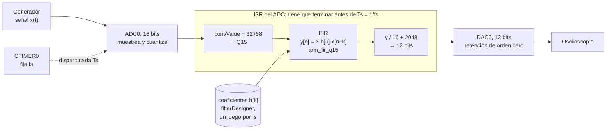

| Bloque | Pregunta que responde | Secciones |
|---|---|---|
| Herramientas | ¿Cómo leo los dB? | 0 |
| Señales y muestreo | ¿Qué es la señal digital y qué relación tiene con la analógica? | 1–3 |
| Sistemas y respuesta en frecuencia | ¿Qué le hace un filtro a la señal? | 4–7 |
| Especificación y diseño | ¿Cómo traduzco "Fc = 35 Hz, 30 dB" en coeficientes? | 8–14 |
| Implementación | ¿Cómo lo calculo en el micro, en punto fijo y a tiempo? | 15–18 |
| Medición y repaso | ¿Cómo verifico que funciona? | 19–22 |

---

# Parte 0 – Herramienta previa

## 0. Los decibeles

Casi todos los números de este TP están en dB (Astop = 30 dB, Apass = 1 dB, SNR = 74 dB…), así que esto va primero.

### 0.1 Qué es un dB

Un dB **no es una cantidad, es una comparación** entre dos valores. Responde a la pregunta "¿cuántas veces más grande (o más chico) es esto que aquello?", pero en escala logarítmica.

Para **amplitudes** (tensiones, lo que medís en el osciloscopio):

$$G_{dB} = 20 \log_{10}\left(\frac{A_{salida}}{A_{entrada}}\right)$$

En texto plano: `dB = 20 · log10(salida / entrada)`.

Cómo leer el resultado:

| Resultado | Significa |
|---|---|
| 0 dB | salida = entrada |
| negativo | la salida es **más chica** (atenuación) |
| positivo | la salida es **más grande** (ganancia) |

### 0.2 Las dos direcciones de la cuenta

**De "veces" a dB** (lo que hacés después de medir en el osciloscopio):

```
Entrada 2 Vpp, salida 50 mVpp

  1) cociente:   0,050 / 2 = 0,025
  2) log10:      log10(0,025) = −1,602
  3) × 20:       20 · (−1,602) = −32,0 dB
```

**De dB a "veces"** (lo que hacés para saber qué esperar). Se despeja la fórmula de arriba:

$$\text{factor} = 10^{G_{dB}/20}$$

```
¿Cuánto es −30 dB?

  1) dividir por 20:   −30 / 20 = −1,5
  2) elevar 10 a eso:  10^(−1,5) = 0,0316
  3) leerlo:           la salida es 0,0316 veces la entrada
                       = la entrada dividida por 1 / 0,0316 = 31,6 veces más chica
```

### 0.3 Las reglas para hacerlo de cabeza

| dB | Factor | Cómo leerlo |
|---|---|---|
| +6 | × 2 | el doble |
| 0 | × 1 | igual |
| −3 | × 0,71 | baja ~30 % (la "frecuencia de corte" clásica) |
| −6 | × 0,5 | la mitad |
| −10 | × 0,32 | ≈ un tercio |
| −20 | × 0,1 | la décima parte |
| −40 | × 0,01 | la centésima parte |

**Los dB se suman cuando los factores se multiplican.** Con eso descomponés cualquier valor en piezas conocidas:

```
−30 dB = −20 dB + (−10 dB)  →  × 0,1 × 0,32 = × 0,032   (31,6 veces más chica)
−26 dB = −20 dB + (−6 dB)   →  × 0,1 × 0,5  = × 0,05    (20 veces más chica)
−46 dB = −40 dB + (−6 dB)   →  × 0,01 × 0,5 = × 0,005   (200 veces más chica)
```

Lo mismo pasa con filtros en cascada: si una etapa atenúa 20 dB y otra 10 dB, el total es 30 dB. No hace falta multiplicar.

### 0.4 Ejemplo del TP: ¿qué tengo que ver en el osciloscopio?

La consigna pide **Astop = 30 dB** para el pasa altos. Con 2 Vpp de entrada:

```
Factor para −30 dB:     10^(−30/20) = 0,0316
Salida máxima permitida: 2 Vpp × 0,0316 = 0,063 Vpp = 63 mVpp
```

**Cómo leerlo:** en la banda de rechazo (por ejemplo, un seno de 3 Hz), la salida tiene que medir **63 mVpp o menos**. Si medís 50 mVpp, cumple, porque −32 dB es más atenuación que −30 dB. Si medís 100 mVpp, no cumple, porque eso da −26 dB.

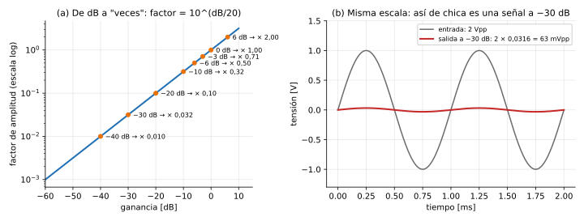

*(a) Cada punto es una de las reglas de la tabla. (b) Entrada de 2 Vpp y la misma señal atenuada 30 dB, en la misma escala: es casi una línea.*

### 0.5 "Atenuación de 30 dB" y "ganancia de −30 dB" son lo mismo

Es una convención de lenguaje:

- **Ganancia** = salida/entrada en dB. Si la salida es más chica, es **negativa**: −30 dB.
- **Atenuación** = cuánto se achica, dicho como **número positivo**: 30 dB.

`filterDesigner` y la consigna usan la segunda forma (Astop = 30, Apass = 1). Los gráficos de respuesta en frecuencia usan la primera (el eje va de 0 hacia abajo: −10, −20, −30 dB). Son la misma información.

### 0.6 ¿Por qué 20 y no 10?

El dB se definió originalmente para **potencias**: `dB = 10 · log10(P2 / P1)`. La potencia es proporcional a la amplitud al cuadrado, así que:

```
10 · log10( (A2/A1)² ) = 20 · log10(A2/A1)
```

Por eso, con tensiones se usa **20**, y con potencias, **10**. El número en dB es el mismo en los dos casos: −30 dB en tensión es −30 dB en potencia. Lo que cambia es el factor: × 0,0316 en tensión equivale a × 0,001 en potencia.

### 0.7 dB "relativos a algo"

Un dB siempre compara contra una referencia. Cuando no hay dos señales, la referencia se fija por convención:

| Notación | Referencia | Ejemplo |
|---|---|---|
| dB (ganancia de un filtro) | la entrada del filtro | −30 dB en la banda de rechazo |
| dBFS (*full scale*) | la senoidal más grande que entra en el conversor | el ruido de un DAC de 12 bits está en ≈ −74 dBFS |
| SNR en dB | el ruido | SNR = 74 dB: la señal es 5000 veces mayor que el ruido |

Por eso hay valores que aparecen a veces positivos y a veces negativos: depende de qué se pone arriba y qué abajo en el cociente (sección 3.2).

---

# Parte I – Señales y muestreo

## 1. Señales

### 1.1 Qué es una señal

Una **señal** es una magnitud que varía con el tiempo y lleva información. Hay tres clases:

| Clase | Tiempo | Amplitud | En el TP |
|---|---|---|---|
| Analógica | continuo | cualquier valor | salida del generador, entrada del ADC |
| Discreta | solo en los instantes $nT_s$ | cualquier valor | concepto teórico (lo que estudia la matemática) |
| Digital | solo en los instantes $nT_s$ | **redondeada a escalones** (bits) | lo que hay en `buffer_in[]` |

### 1.2 La senoidal: la señal de prueba fundamental

$$x(t) = A \cos(2\pi f t + \varphi)$$

| Parámetro | Qué es | Cómo se ve en el osciloscopio |
|---|---|---|
| $A$ | amplitud: de 0 al pico | Vpp = 2A (pico a pico) |
| $f$ | frecuencia: ciclos por segundo | período = 1/f |
| $\varphi$ | fase: dónde arranca el ciclo | corrimiento horizontal |

Ejemplo: un seno de 1 Vpp y 100 Hz tiene $A$ = 0,5 V y período de 10 ms.

**Por qué es la señal fundamental:**

1. **Fourier:** toda señal práctica se puede ver como una **suma de senoidales**. El gráfico de cuánto hay de cada frecuencia se llama **espectro**. Por ejemplo, una cuadrada de frecuencia $f_0$ y amplitud 1 contiene:

   ```
   frecuencia:   f0     3·f0    5·f0    7·f0   ...   (solo impares)
   amplitud:     1,27   0,42    0,25    0,18   ...   (= 4/π · 1/k)
   ```

   Una cuadrada de 1 kHz es, en realidad, una senoidal de 1 kHz, más una de 3 kHz, más una de 5 kHz, y así siguiendo.

2. **Un filtro lineal no crea frecuencias nuevas.** Si entra una senoidal, sale **una senoidal de la misma frecuencia**, solo que con otra amplitud y otra fase (sección 4). Por eso un filtro se describe completo diciendo, para cada frecuencia, **cuánto la achica y cuánto la corre**. Esa descripción es la **respuesta en frecuencia**.

### 1.3 La componente de continua (DC)

Es la "frecuencia 0", el **valor medio** de la señal. Una senoidal de 1 Vpp montada sobre 1,65 V tiene una continua de 1,65 V.

En el TP la señal del generador **tiene que** tener continua, porque el ADC solo acepta tensiones positivas (sección 3.3). El pasa altos **elimina la continua**: es una de las cosas que la consigna le pide.

## 2. Muestreo

### 2.1 Qué es muestrear

Muestrear es medir la señal cada $T_s$ segundos y quedarse solo con esos valores:

$$x[n] = x(n T_s)$$

En el TP, el CTIMER0 dispara el ADC a $f_s$ muestras por segundo:

| $f_s$ | 8 kHz | 16 kHz | 22 kHz | 44 kHz | 48 kHz |
|---|---|---|---|---|---|
| $T_s = 1/f_s$ | 125 µs | 62,5 µs | 45,5 µs | 22,7 µs | 20,8 µs |
| Nyquist $f_s/2$ | 4 kHz | 8 kHz | 11 kHz | 22 kHz | 24 kHz |

### 2.2 El teorema de Nyquist

> Una señal se puede reconstruir a partir de sus muestras **si no tiene componentes por encima de $f_s/2$**.

A $f_s/2$ se la llama **frecuencia de Nyquist**.

**Intuición:** para "dibujar" un ciclo de una onda hacen falta **más de 2 muestras por ciclo**. Con fs = 8 kHz:

```
señal de 1 kHz → 8000 / 1000 = 8 muestras por ciclo     bien
señal de 4 kHz → 8000 / 4000 = 2 muestras por ciclo     justo en el límite
señal de 5 kHz → 8000 / 5000 = 1,6 muestras por ciclo   no alcanza
```

### 2.3 Aliasing: qué pasa si no se respeta Nyquist

Si entra una frecuencia mayor que $f_s/2$, sus muestras son **idénticas** a las de otra frecuencia más baja. Después del ADC son exactamente los mismos números, así que no hay forma de distinguirlas. Eso es el **aliasing** (la frecuencia alta se disfraza de baja).

**Ejemplo paso a paso: 5 kHz muestreada a 8 kHz.** La muestra $n$ de una senoidal es `x[n] = cos(2π · (f/fs) · n)`. Para 5 kHz:

```
cos(2π · (5000/8000) · n)
  = cos(2π·n − 2π · (3000/8000) · n)     ← porque 5000/8000 = 1 − 3000/8000
  = cos(−2π · (3000/8000) · n)           ← 2π·n es una vuelta entera (n es entero): no cambia nada
  = cos( 2π · (3000/8000) · n)           ← el coseno es par: cos(−a) = cos(a)
```

El resultado es igual muestra por muestra a una senoidal de **3 kHz**.

**La regla general: el espectro se "dobla" en fs/2.** Imaginá el eje de frecuencias doblado como un acordeón en 4 kHz, 8 kHz, 12 kHz… Toda frecuencia termina cayendo entre 0 y 4 kHz:

```
f_alias = | f − k · fs |      con el entero k que deje el resultado entre 0 y fs/2
```

Con fs = 8 kHz:

| Entrada | Se ve como | Cuenta |
|---|---|---|
| 1 kHz | 1 kHz | menor que 4 kHz: sin problema |
| 3 kHz | 3 kHz | menor que 4 kHz: sin problema |
| 4 kHz | 4 kHz (ambiguo) | justo en el límite: la amplitud depende de dónde caen las muestras |
| **5 kHz** | **3 kHz** | \|5 − 8\| = 3 |
| 7 kHz | 1 kHz | \|7 − 8\| = 1 |
| 8 kHz | **0 Hz (continua)** | \|8 − 8\| = 0: se muestrea siempre en el mismo punto del ciclo |
| 11 kHz | 3 kHz | \|11 − 8\| = 3 |
| 13 kHz | 3 kHz | \|13 − 16\| = 3 |

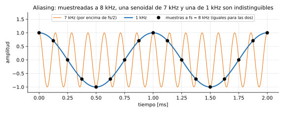

*Las dos senoidales pasan exactamente por las mismas muestras: después del ADC no hay forma de separarlas.*

**Qué pasa en el TP si metés 5 kHz a fs = 8 kHz:**

1. El ADC entrega muestras de una senoidal de 3 kHz. A partir de ahí, lo único que "existe" en el micro es esa señal de 3 kHz.
2. **El filtro no lo puede corregir.** Recibe 3 kHz y la trata como 3 kHz:
   - el pasa altos de 35 Hz la deja pasar;
   - el pasa bajos de 3600 Hz también;
   - el pasa banda de 35–3500 Hz también.
3. En el osciloscopio ves **3 kHz** a la salida, aunque el generador diga 5 kHz. Es una buena prueba para el informe: si subís el generador de 4 a 8 kHz, la salida *baja* de 4 a 0 kHz.

**Cómo se previene.** El aliasing **no tiene arreglo después del ADC**. Se previene antes: con un **filtro antialiasing analógico** que corte todo lo que esté por encima de $f_s/2$, o, si no lo hay, cuidando que el generador no supere $f_s/2$.

Ojo con las cuadradas. Una cuadrada de 1 kHz tiene armónicos en 3, 5, 7, 9 kHz… A fs = 8 kHz, el de 5 kHz se dobla a 3 kHz y el de 7 kHz a 1 kHz, encima de los armónicos verdaderos. Por eso, a fs bajas, una cuadrada se ve deformada aunque el filtro esté en BYPASS.

### 2.4 Frecuencia digital: el concepto más importante del TP

Una vez muestreada la señal, el micro solo ve una lista de números. No sabe cuántos segundos pasan entre muestras. Lo único que "ve" es **cuánto avanza la onda de una muestra a la siguiente**. Esa es la **frecuencia digital**:

$$\omega = 2\pi \frac{f}{f_s} \quad \text{[radianes por muestra]}$$

En texto plano: `ω = 2π · f / fs`.

**Cómo se lee:** ω es el ángulo que gira la senoidal entre una muestra y la siguiente.

```
f = 1 kHz, fs = 8 kHz → ω = 2π · 1000/8000 = π/4 rad   (45° por muestra: 8 muestras por vuelta)
f = 4 kHz, fs = 8 kHz → ω = π rad                      (180° por muestra: Nyquist)
f = 35 Hz, fs = 8 kHz → ω = 2π · 35/8000 = 0,0275 rad  (1,6° por muestra)
```

El rango útil es de 0 a π, que corresponde a 0 a $f_s/2$. `filterDesigner` también usa la **frecuencia normalizada** $f/(f_s/2)$, donde 1 es Nyquist: 35 Hz a 8 kHz es 35/4000 = 0,00875.

**La consecuencia directa: un filtro digital no "sabe" de Hz.** Los coeficientes definen qué hace el filtro para cada **ω**. Si cambiás la fs y dejás los mismos coeficientes, el filtro sigue cortando en el mismo ω, que ahora corresponde a otra frecuencia en Hz:

```
Pasa altos diseñado para 8 kHz, con corte en 35 Hz:
  ω_corte = 2π · 35 / 8000 = 0,0275 rad/muestra

Mismos coeficientes usados a 48 kHz:
  f_corte = ω · fs / 2π = 0,0275 · 48000 / 2π = 210 Hz     (6 veces más arriba)
```

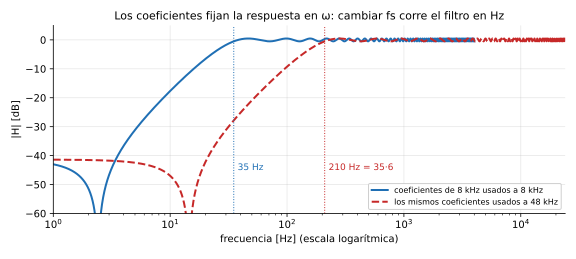

*El pasa altos diseñado para 8 kHz, usado a 48 kHz, tiene el corte 6 veces más arriba.*

**Por qué importa en el TP:** por eso hay **un juego de coeficientes por cada fs**: 5 fs × 4 tipos = 20 filtros. El define `SOLO_8K` de `TP2.c` existe justamente para ver este efecto en el osciloscopio.

Hay otra consecuencia: al subir fs, los 35 Hz quedan cada vez más cerca de 0 en la escala digital (0,0275 rad a 8 kHz y 0,0046 rad a 48 kHz). Distinguir frecuencias tan juntas cuesta muchos coeficientes (sección 9).

## 3. Cuantización y conversión

### 3.1 Los escalones del conversor

El ADC no puede representar cualquier tensión: divide su rango en una cantidad fija de **escalones**. Con $B$ bits hay $2^B$ escalones:

```
escalón = rango / 2^B
```

Por ejemplo, con un rango de 3,3 V:

| Conversor | Bits | Escalones | Tamaño del escalón |
|---|---|---|---|
| ADC0 (TP2) | 16 | 65 536 | 3,3 V / 65 536 = 50 µV |
| DAC0 | 12 | 4 096 | 3,3 V / 4 096 = 0,8 mV |

Cada muestra se **redondea al escalón más cercano**, así que se comete un error de hasta **medio escalón**.

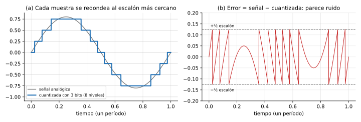

*Con 3 bits (8 niveles), para que se vean los escalones. Con 12 bits los escalones son 512 veces más finos. El error en (b) nunca pasa de ±½ escalón y cambia de forma irregular: se comporta como un ruido sumado a la señal.*

### 3.2 La SNR (relación señal/ruido)

**Qué es.** Cuántas veces más grande es la señal que el ruido, expresado en dB:

$$\text{SNR} = 20 \log_{10}\left(\frac{A_{senal}}{A_{ruido}}\right)$$

En texto plano: `SNR = 20 · log10(señal / ruido)`.

**Cómo se lee.**

| SNR | Significa |
|---|---|
| 60 dB | la señal es 1000 veces mayor que el ruido |
| 20 dB | la señal es 10 veces mayor que el ruido: se nota el ruido |
| 0 dB | señal y ruido son iguales |
| negativa | **hay más ruido que señal** (pasa, por ejemplo, con el GPS, que recibe señales por debajo del ruido) |

**¿Por qué a veces aparece negativa?** Es la misma comparación vista desde el otro lado:

```
señal / ruido = 5000  →  20 · log10(5000)   = +74 dB    ← SNR: la señal es 5000 veces el ruido
ruido / señal = 1/5000 → 20 · log10(1/5000) = −74 dB    ← "el ruido está 74 dB por debajo de la señal"
```

Las dos dicen lo mismo. La SNR se expresa **positiva** cuando la señal es mayor que el ruido, que es el caso normal. El **nivel del ruido** se expresa **negativo** cuando se mide relativo a la señal o al fondo de escala (dBFS), porque el ruido es más chico que la referencia. Cuando se dice "el piso de ruido está en −74 dB", se está usando la segunda forma.

**La SNR del conversor.** El ruido de cuantización depende del tamaño del escalón, y cada bit extra **divide el escalón por 2**, o sea, −6 dB de ruido. Para una senoidal que ocupa todo el rango:

$$\text{SNR}_{max} \approx 6{,}02 \cdot B + 1{,}76 \text{ dB}$$

| Conversor | Bits | SNR máxima | Cómo leerlo |
|---|---|---|---|
| ADC0 | 16 | ≈ 98 dB | el ruido es ~80 000 veces más chico que la señal |
| DAC0 | 12 | ≈ 74 dB | el ruido es ~5 000 veces más chico que la señal |

**Por qué importa en el TP:**

1. **La cadena queda limitada por el DAC (74 dB).** Aunque el ADC sea mejor, la salida pasa por 12 bits.
2. **Por eso los 30 dB del filtro se pueden medir.** La señal atenuada (−30 dB) está muy por encima del piso de ruido del DAC (−74 dB): hay 44 dB de margen. Si la consigna pidiera 90 dB, el ruido del DAC taparía la señal.
3. **La SNR máxima es con la señal a fondo de escala.** Si usás la mitad de la amplitud, perdés 6 dB. Conviene medir con amplitudes grandes, sin llegar a saturar.

En la práctica, el ruido analógico de la placa y del generador suele ser mayor que el de cuantización. Los 74 y 98 dB son el máximo teórico.

### 3.3 Cómo se centra la señal: de `convValue` a Q15

El problema es este: **el ADC entrega números sin signo y el filtro trabaja con números con signo**.

**Paso 1: lo que entrega el ADC.** El ADC solo mide tensiones positivas, entre 0 V y Vref. Por eso el generador tiene que tener un **offset**: la senoidal oscila alrededor de Vref/2. El ADC de 16 bits convierte ese rango a números de 0 a 65535:

```
tensión       convValue
0 V           0
Vref/2        32768      ← el "centro" de la señal
Vref          65535
```

Una senoidal centrada en Vref/2 da números que oscilan **alrededor de 32768**, por ejemplo entre 9 000 y 56 000.

**Paso 2: por qué no se puede usar así.** El formato Q15 es un `int16_t` **con signo**: va de −32768 a +32767. Hay dos problemas:

- **No entra:** todo valor mayor que 32767 (la mitad de arriba de la señal) "da la vuelta" y aparece como un número negativo. La señal queda destrozada (figura, panel c).
- **El filtro espera una señal centrada en 0**, que vaya de negativo a positivo, no montada sobre una continua enorme.

**Paso 3: la resta.**

```c
buffer_in[i] = (q15_t)((int32_t)result.convValue - 32768);
```

Restarle 32768 **corre todo hacia abajo**, de forma que el centro pase a ser 0:

```
tensión     convValue    − 32768 = Q15      como fracción
0 V         0            −32768             −1,0
Vref/4      16384        −16384             −0,5
Vref/2      32768             0              0      ← centro de la señal
3·Vref/4    49152        +16384             +0,5
Vref        65535        +32767             ≈ +1,0
```

Ahora la senoidal oscila alrededor de 0, con picos positivos y negativos, y cabe exactamente en Q15.

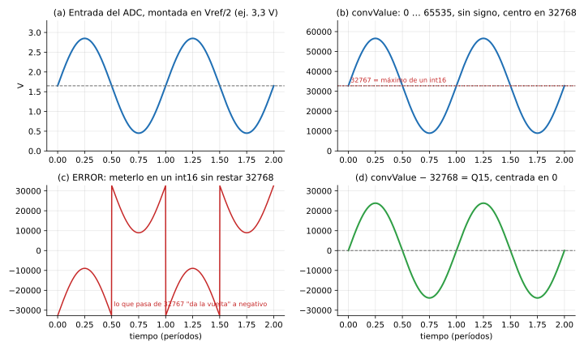

*(a) La tensión que entra al ADC. (b) Los números que entrega: todos positivos y centrados en 32768. (c) Lo que pasa si se meten en un int16 sin restar: la mitad de arriba se da vuelta. (d) Después de restar 32768: centrada en 0.*

**Paso 4: el camino de vuelta, hacia el DAC.** El DAC es de 12 bits y **sin signo** (0 a 4095), así que hay que deshacer el centrado:

```c
out_dac = (buffer_out[i] / 16) + 2048;
```

Son dos operaciones:

- **`/ 16`:** pasa de 16 bits a 12 bits, porque 65536 / 16 = 4096. El rango −32768…+32767 pasa a −2048…+2047.
- **`+ 2048`:** vuelve a montar la señal sobre la mitad de escala del DAC. El rango queda en 0…4095.

```
Q15        / 16       + 2048 = DAC    tensión de salida
−32768     −2048      0               0 V
     0         0      2048            Vref_DAC / 2   ← centro
+32767     +2047      4095            ≈ Vref_DAC
```

Si por el filtrado algún valor se sale de 0…4095, el código lo recorta a ese rango.

**Por qué importa en el TP: el pasa altos recentra la señal.**

- **En BYPASS**, si la entrada no estaba exactamente en Vref/2, esa diferencia queda como continua en Q15, y la salida reproduce el mismo corrimiento.
- **Con el pasa altos activo**, el filtro elimina la continua, así que la salida queda **siempre centrada en 2048** (la mitad de escala del DAC), aunque la entrada estuviera corrida.

Si en el osciloscopio ves que al activar el pasa altos la señal "se recentra", ese es el filtro haciendo su trabajo. Para verlo, el osciloscopio tiene que estar en **acople DC**. En acople AC, el osciloscopio saca la continua él mismo y no se nota la diferencia.

### 3.4 El DAC y la reconstrucción

El DAC **mantiene** cada valor durante $T_s$ hasta que llega el siguiente. Esto se llama **retención de orden cero (ZOH)**, y por eso en el osciloscopio se ve una "escalera".

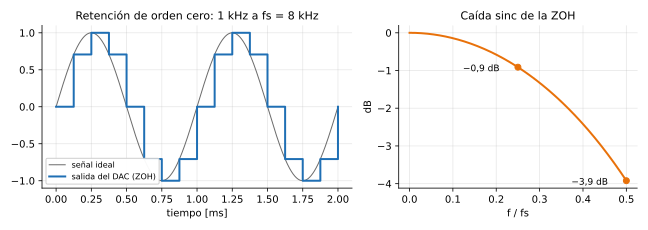

*Izquierda: la escalera que se ve en el osciloscopio (1 kHz a fs = 8 kHz, 8 escalones por ciclo). Derecha: cuánto atenúa la ZOH según la frecuencia.*

Tiene dos efectos:

- **Imágenes.** Los saltos de la escalera contienen frecuencias altas: copias del espectro alrededor de $f_s$, $2f_s$, … Un filtro analógico de reconstrucción las elimina. Sin él, la escalera se ve en pantalla. Cuanto más alta la fs, más escalones por ciclo y más suave se ve.
- **Caída sinc.** La escalera atenúa un poco las frecuencias altas:

  | f / fs | 0,1 | 0,25 | 0,44 | 0,5 (Nyquist) |
  |---|---|---|---|---|
  | Atenuación | −0,14 dB | −0,9 dB | −2,9 dB | −3,9 dB |

  Para el pasa altos de 35 Hz es despreciable. En cambio, se nota en el pasa bajos de 3600 Hz a 8 kHz: 3500 Hz es f/fs = 0,44, así que sale −2,9 dB por culpa del DAC y no del filtro. Conviene saberlo antes de medir.

---

# Parte II – Sistemas y respuesta en frecuencia

## 4. Sistemas LTI y convolución

### 4.1 Qué es un sistema LTI

Un filtro digital es un **sistema**: recibe una secuencia $x[n]$ y produce otra $y[n]$. Los filtros que usamos son **LTI**:

| Propiedad | Qué dice | Ejemplo |
|---|---|---|
| **Lineal** | la respuesta a una suma es la suma de las respuestas, y escalar la entrada escala la salida | si 1 V a 100 Hz sale como 0,9 V, entonces 2 V salen como 1,8 V |
| **Invariante en el tiempo** | el filtro se comporta igual hoy que mañana: retrasar la entrada solo retrasa la salida | los coeficientes no cambian mientras corre |

### 4.2 Respuesta al impulso

El **impulso** $\delta[n]$ es la señal más simple: un 1 en $n = 0$ y ceros en el resto (`1, 0, 0, 0, …`). La **respuesta al impulso** $h[n]$ es lo que sale del filtro cuando entra un impulso.

**Por qué es tan importante:** cualquier señal es una suma de impulsos escalados y retrasados. Por ejemplo, `x = [3, 1, 2]` es `3·δ[n] + 1·δ[n−1] + 2·δ[n−2]`. Si el sistema es LTI, la salida es la suma de las respuestas a cada impulso. Por eso **$h[n]$ describe completamente al filtro**.

En un FIR, $h[n]$ son **exactamente los coeficientes** que exporta `filterDesigner`.

### 4.3 Convolución: la cuenta que hace el filtro

$$y[n] = \sum_{k=0}^{N} h[k] \cdot x[n-k]$$

En texto plano: `y[n] = h[0]·x[n] + h[1]·x[n−1] + h[2]·x[n−2] + … + h[N]·x[n−N]`.

**Cómo se lee:** la salida es una **suma pesada de la muestra actual y de las $N$ anteriores**. Los pesos son los coeficientes.

**Ejemplo paso a paso** con un filtro de 3 coeficientes, `h = [0,25 ; 0,5 ; 0,25]`, y una entrada que "salta" de 0 a 4 y vuelve a 0:

```
y[n] = 0,25·x[n] + 0,5·x[n−1] + 0,25·x[n−2]

n    x[n]   x[n−1]  x[n−2]   cuenta                       y[n]
0    0      0       0        0                            0
1    0      0       0        0                            0
2    4      0       0        0,25·4                       1
3    4      4       0        0,25·4 + 0,5·4               3
4    4      4       4        0,25·4 + 0,5·4 + 0,25·4      4
5    0      4       4        0      + 0,5·4 + 0,25·4      3
6    0      0       4        0      + 0     + 0,25·4      1
7    0      0       0        0                            0
```

La salida es `0, 0, 1, 3, 4, 3, 1, 0`: **una versión suavizada** de la entrada, con los bordes redondeados. Es un pasa bajos. Fijate también que el centro del pulso de salida está corrido una muestra respecto del de entrada: ese es el **retardo** del filtro (sección 7).

### 4.4 Causalidad y estabilidad

- **Causal:** la salida depende solo de la muestra actual y de las pasadas, nunca de las futuras. En tiempo real es obligatorio, porque la muestra futura todavía no llegó.
- **Estable (BIBO):** si la entrada está acotada, la salida también. **Un FIR siempre es estable**: es una suma de una cantidad finita de términos acotados.

### 4.5 La ecuación general: FIR e IIR

Las diapositivas del curso presentan la "expresión general de un filtro digital":

$$y[n] = \sum_{k=0}^{M} b_k \cdot x[n-k] - \sum_{k=1}^{P} a_k \cdot y[n-k]$$

- Los términos $b_k$ usan **entradas** (actual y pasadas).
- Los términos $a_k$ usan **salidas pasadas**: es una **realimentación**.

**Diseñar un filtro es calcular los coeficientes $a$ y $b$.** Si todos los $a_k$ son 0 (sin realimentación), el filtro es **FIR**. Si hay realimentación, es **IIR**.

## 5. Respuesta en frecuencia

### 5.1 Qué es

Es la respuesta a la pregunta: **si entra una senoidal de frecuencia $f$, ¿cuánto se achica y cuánto se corre?**

Para cada frecuencia, la respuesta en frecuencia da dos números:

- **Ganancia** $|H|$: por cuánto se multiplica la amplitud. En dB: $20 \log_{10}|H|$.
- **Fase** $\phi$: cuánto se corre la senoidal, en radianes o en grados.

Se calcula a partir de los coeficientes:

$$H(e^{j\omega}) = \sum_{k=0}^{N} h[k] \cdot e^{-j\omega k}$$

No hace falta hacer esta cuenta a mano. `filterDesigner` y MATLAB (`freqz`) la hacen y la grafican. Lo importante es la idea: **cada coeficiente aporta una senoidal retrasada $k$ muestras, y según la frecuencia esos aportes se suman (pasa) o se cancelan (no pasa).**

### 5.2 Ejemplo: los dos filtros más simples posibles

**Promedio de 2 muestras:** `h = [0,5 ; 0,5]`, es decir, `y[n] = (x[n] + x[n−1]) / 2`.

```
Continua (0 Hz):  x = 1, 1, 1, 1…         → y = (1+1)/2 = 1          ganancia 1      (0 dB)
Nyquist (4 kHz):  x = 1, −1, 1, −1…       → y = (1 + (−1))/2 = 0     ganancia 0      (−∞ dB)
2 kHz:            ganancia = cos(π/4) = 0,707                        (−3 dB)
```

Las frecuencias bajas pasan y las altas se cancelan: es un **pasa bajos**.

**Diferencia de 2 muestras:** `h = [0,5 ; −0,5]`, es decir, `y[n] = (x[n] − x[n−1]) / 2`.

```
Continua (0 Hz):  x = 1, 1, 1, 1…         → y = (1 − 1)/2 = 0        ganancia 0
Nyquist (4 kHz):  x = 1, −1, 1, −1…       → y = (1 − (−1))/2 = 1     ganancia 1
```

Lo que no cambia (la continua) se anula y lo que cambia rápido pasa: es un **pasa altos**.

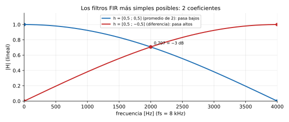

*Con 2 coeficientes la transición ocupa toda la banda, de 0 a 4 kHz. Para que el pasa altos de la consigna pase de "rechazo" a "paso" entre 5 y 35 Hz hacen falta cientos de coeficientes (sección 9).*

### 5.3 Propiedades que conviene saber

- **Es periódica:** se repite cada $f_s$, que es el mismo fenómeno del aliasing. Por eso alcanza con mirarla entre 0 y $f_s/2$, y es lo que muestran todos los gráficos.
- **Transformada Z:** la respuesta en frecuencia es un caso particular de la función de transferencia $H(z) = \sum h[k] z^{-k}$, evaluada en $z = e^{j\omega}$. El símbolo $z^{-1}$ significa "**retardo de una muestra**", y en hardware es un registro o una posición del buffer.
  - **Ceros** de $H(z)$: frecuencias que el filtro anula. El promedio de 2 tiene un cero en Nyquist.
  - **Polos**: solo los tienen los IIR. **Un FIR no tiene polos**, y por eso necesita muchos coeficientes para lograr cortes abruptos.

### 5.4 Tabla de dB para el osciloscopio

| Ganancia | Factor | Con 2 Vpp a la entrada se ve |
|---|---|---|
| 0 dB | 1 | 2 Vpp |
| −0,5 dB | 0,944 | 1,89 Vpp |
| −1 dB | 0,891 | 1,78 Vpp |
| −3 dB | 0,708 | 1,42 Vpp |
| −6 dB | 0,501 | 1,00 Vpp |
| −20 dB | 0,1 | 200 mVpp |
| **−30 dB** | **0,0316** | **63 mVpp** |
| −40 dB | 0,01 | 20 mVpp |

## 6. FIR frente a IIR

### 6.1 La diferencia, con un ejemplo

**FIR** (*Finite Impulse Response*). Solo usa entradas: `y[n] = 0,5·x[n] + 0,5·x[n−1]`. Si entra un impulso, la salida es `0,5, 0,5, 0, 0, 0…`: **termina** después de L muestras.

**IIR** (*Infinite Impulse Response*). Usa su propia salida anterior: `y[n] = x[n] + 0,9·y[n−1]`. Si entra un impulso:

```
y[0] = 1
y[1] = 0 + 0,9·1     = 0,9
y[2] = 0 + 0,9·0,9   = 0,81
y[3] = 0 + 0,9·0,81  = 0,729
…  nunca llega exactamente a 0: la respuesta es infinita
```

Con un solo coeficiente de realimentación, el IIR "recuerda" toda la historia. Por eso logra mucha selectividad con muy pocos coeficientes.

### 6.2 Comparación

| | FIR | IIR |
|---|---|---|
| Ecuación | solo entradas | entradas y salidas pasadas (recursivo) |
| Respuesta al impulso | finita (L muestras) | infinita (decae) |
| Polos | no tiene | sí: dan selectividad con pocos coeficientes |
| Estabilidad | siempre estable | hay que garantizarla |
| Fase | **puede ser exactamente lineal** | no lineal |
| Orden para la misma especificación | alto | bajo |
| Sensibilidad a la cuantización | baja | alta (los polos se corren y puede volverse inestable) |
| Pasa altos de la consigna a 8 kHz | ≈ 260 coeficientes | Butterworth de **orden 3** |

La última fila muestra el costo del FIR: para el mismo pasa altos, un IIR de orden 3 (unas 7 multiplicaciones por muestra) hace lo que un FIR de 261 coeficientes, aunque con fase no lineal. Es una buena conclusión para el informe y conecta con la parte de IIR de la materia.

## 7. Fase lineal y retardo de grupo

### 7.1 Qué es la fase en el tiempo

Correr una senoidal en el tiempo equivale a cambiarle la fase:

```
retardo de 1 ms en una senoidal de 100 Hz (período 10 ms)
  = 1/10 de ciclo = 36°
retardo de 1 ms en una senoidal de 500 Hz (período 2 ms)
  = 1/2 ciclo = 180°
```

Para que **todas** las frecuencias se atrasen el mismo tiempo, la fase tiene que crecer **proporcional a la frecuencia**. Eso es la **fase lineal**:

$$\phi(\omega) = -\tau \cdot \omega$$

### 7.2 Por qué importa

- **Con fase lineal**, todas las componentes de una señal se atrasan lo mismo, así que la forma de onda sale **intacta, solo corrida**.
- **Con fase no lineal**, cada componente se atrasa distinto y la forma se **deforma**. Por ejemplo, una cuadrada que pasa por la banda de paso sale con otra forma, aunque ninguna de sus componentes se haya atenuado.

El **retardo de grupo** mide ese atraso en muestras:

$$\tau_g = -\frac{d\phi}{d\omega}$$

Con fase lineal es constante: el mismo para todas las frecuencias.

### 7.3 Simetría ⇒ fase lineal

Un FIR tiene fase lineal si sus coeficientes son **simétricos**, $h[k] = h[N-k]$, como un espejo respecto del centro. Por ejemplo, `[0,25 ; 0,5 ; 0,25]` es simétrico.

**Intuición:** cada par de coeficientes iguales está a la misma distancia del centro, uno antes y uno después. Sus aportes se combinan de forma que el resultado queda "centrado" en la muestra del medio, para cualquier frecuencia. Todo el filtro se comporta como si estuviera retrasado **exactamente hasta el centro**:

$$\tau_g = \frac{N}{2} \text{ muestras} = \frac{N}{2 f_s} \text{ segundos}$$

```
Ejemplo de 3 coeficientes [0,25 ; 0,5 ; 0,25]: N = 2 → τg = 1 muestra
  (en la convolución de la sección 4.3, el centro del pulso se corrió 1 muestra)

Pasa altos recomendado: N = 260 a 8 kHz
  τg = 260/2 = 130 muestras = 130 / 8000 = 16,25 ms
  Una senoidal de 100 Hz (período 10 ms) sale 1,625 ciclos atrasada.
```

En el osciloscopio se ve como un corrimiento constante entre la entrada y la salida (figura de la sección 13.3).

Hay un detalle práctico que sale de la simetría: CMSIS pide los coeficientes en orden invertido, pero **para un filtro simétrico el orden invertido es el mismo**.

### 7.4 Los cuatro tipos de FIR de fase lineal

| Tipo | Simetría | Orden N | Ceros forzados | Sirve para |
|---|---|---|---|---|
| **I** | simétrico | par (L impar) | ninguno | **cualquier filtro** |
| II | simétrico | impar (L par) | en Nyquist ($f_s/2$) | PB y PBanda. **No sirve para PA ni EB** |
| III | antisimétrico | par | en 0 y en $f_s/2$ | diferenciadores, Hilbert |
| IV | antisimétrico | impar | en 0 | diferenciadores, Hilbert |

**Por qué el tipo II tiene un cero en Nyquist.** En Nyquist la entrada es `1, −1, 1, −1…`. Con L par, los coeficientes forman pares simétricos en los que uno multiplica a un +1 y el otro a un −1, así que cada par se cancela y la salida es 0, sin importar el diseño. El promedio de 2 de la sección 5.2 es el ejemplo más chico.

**Para el pasa altos:** el tipo II tiene ganancia cero justo donde el pasa altos tiene que dejar pasar. Por eso **el orden del pasa altos tiene que ser par** (tipo I), y `filterDesigner` lo fuerza. Lo mismo vale para el elimina banda.

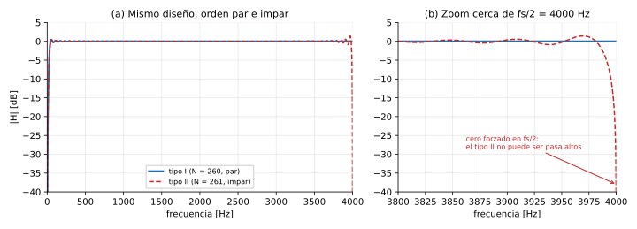

*El mismo diseño con orden impar (tipo II) se desploma al llegar a fs/2.*

---

# Parte III – Especificación del filtro

## 8. La plantilla de tolerancias

### 8.1 Por qué hace falta una plantilla

El filtro **ideal** tendría ganancia exactamente 1 en la banda de paso, exactamente 0 en la de rechazo y un corte vertical. **No se puede construir**: su respuesta al impulso es infinita y empieza antes de $n = 0$ (sección 10).

Por eso se especifica una **plantilla de tolerancias**: zonas por donde la respuesta puede pasar y zonas prohibidas. Cualquier filtro cuya respuesta caiga dentro de la plantilla sirve.

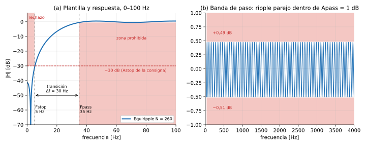

*Las zonas rojas son las prohibidas. (a) Rechazo de 0 a 5 Hz por debajo de −30 dB, transición de 5 a 35 Hz y banda de paso desde 35 Hz. (b) En la banda de paso, Equiripple oscila de borde a borde de la tolerancia, por eso es óptimo.*

### 8.2 Cada parámetro, qué dice y cómo se lee

| Parámetro | Qué es | Valor elegido | Cómo leerlo |
|---|---|---|---|
| **Fstop** | borde de la banda de rechazo | 5 Hz | de 0 a 5 Hz la señal **tiene que** salir atenuada al menos Astop |
| **Fpass** | borde de la banda de paso | 35 Hz | de 35 Hz a fs/2 la señal **tiene que** salir casi intacta |
| **Δf = Fpass − Fstop** | ancho de la transición | 30 Hz | entre 5 y 35 Hz el filtro "baja" de una banda a la otra, y ahí vale cualquier cosa |
| **Astop** | atenuación mínima en la banda de rechazo | 30 dB (31 con margen) | la señal rechazada sale al menos 31,6 veces más chica |
| **Apass** | ripple máximo en la banda de paso, pico a pico | 1 dB | la ganancia puede variar 1 dB en total dentro de la banda de paso |
| **fs** | frecuencia de muestreo | 8…48 kHz | fija la escala digital (sección 2.4) |

### 8.3 Las cuentas, con el osciloscopio en la mano

Los algoritmos de diseño no trabajan en dB, sino con **desviaciones lineales** (cuánto se puede apartar la ganancia de 1 o de 0):

$$\delta_p = \frac{10^{A_p/20}-1}{10^{A_p/20}+1} \qquad \delta_s = 10^{-A_s/20}$$

**Banda de paso, Apass = 1 dB:**

```
10^(1/20) = 1,122
δp = (1,122 − 1) / (1,122 + 1) = 0,0575

La ganancia puede ir de 1 − 0,0575 = 0,9425 a 1 + 0,0575 = 1,0575
En dB:                  −0,51 dB   a   +0,49 dB     (en total, 1 dB pico a pico)

Con 2 Vpp de entrada, en la banda de paso tenés que medir entre 1,885 y 2,115 Vpp
```

**Banda de rechazo, Astop = 30 dB:**

```
δs = 10^(−30/20) = 0,0316

Con 2 Vpp de entrada, en la banda de rechazo tenés que medir 63 mVpp o menos
(con el margen de 31 dB del diseño: 56 mVpp o menos)
```

### 8.4 ¿Qué es "frecuencia de corte"?

La consigna da "Fc = 35 Hz" sin aclarar qué significa, y hay tres convenciones:

| Convención | Ganancia en Fc | Con 2 Vpp, en Fc se mide | Dónde se usa |
|---|---|---|---|
| Borde de la banda de paso (Fc = Fpass) | ≈ −0,5 dB | ≈ 1,89 Vpp | especificaciones con plantilla (Equiripple, Kaiser con orden mínimo) |
| Punto de −3 dB | 0,708 | 1,42 Vpp | filtros analógicos, Butterworth: la definición "clásica" |
| Punto de −6 dB | 0,5 | 1,00 Vpp | método de ventanas (Window en `filterDesigner`): el corte queda en el medio de la transición |

**Hay que elegir una y declararla en el informe.** En el análisis se eligió Fc = Fpass, la más estricta: a 35 Hz la señal pasa casi entera.

### 8.5 Las cuatro especificaciones de la consigna

| Filtro | Lo que da la consigna | Lo que hay que decidir |
|---|---|---|
| Pasa bajos | Fc = 3600 Hz, Astop = 30 dB | Fstop. A 8 kHz Nyquist es 4000 Hz, así que la transición tiene que entrar en 3600–4000 Hz |
| **Pasa altos** | **Fc = 35 Hz, Astop = 30 dB** | **Fstop (se eligió 5 Hz) y Apass (1 dB)** |
| Pasa banda | Fc1 = 35 Hz, Fc2 = 3500 Hz, Astop = 30 dB | Fstop1, Fstop2 y Apass. El borde de abajo tiene el mismo problema que el pasa altos |
| Elimina banda | Fr = 50 Hz, Bw = 15 Hz, Astop = 25 dB | si Bw es el ancho a −3 dB o el de la banda de rechazo (42,5–57,5 Hz). Las transiciones angostas dan órdenes muy grandes |

## 9. Qué determina el orden

### 9.1 La fórmula de estimación

Kaiser propuso una fórmula que muestra de qué depende el orden:

$$N \approx \frac{A - 7{,}95}{14{,}36 \cdot \Delta f / f_s}$$

$A$ es la atenuación en dB de la banda más exigente: $A = -20 \log_{10}(\min(\delta_p, \delta_s))$.

**Ejemplo paso a paso** (pasa altos, 8 kHz, Astop = 30, Apass = 1):

```
δp = 0,0575, δs = 0,0316  →  la más chica es δs  →  A = 30 dB

Con Fstop = 5 Hz  (Δf = 30 Hz):   N ≈ (30 − 7,95) / (14,36 · 30/8000) = 22,05 / 0,0539 ≈ 410
Con Fstop = 20 Hz (Δf = 15 Hz):   N ≈ 22,05 / (14,36 · 15/8000)       = 22,05 / 0,0269 ≈ 820
```

El segundo caso da exactamente el orden del pasa altos que está hoy en `filtros.h` (822 coeficientes). Fue diseñado así.

### 9.2 Cómo se lee la fórmula

| Si… | el orden… | porque |
|---|---|---|
| duplicás fs | se **duplica** | fs está en el numerador (al dar vuelta el cociente) |
| achicás Δf a la mitad | se **duplica** | Δf está en el denominador |
| subís A de 30 a 40 dB | sube ~45 % | A crece de forma lineal, sumando |

Para este filtro, la decisión que más pesa es **Fstop**, no Astop.

### 9.3 Intuición: el principio de incerteza

Para distinguir dos frecuencias separadas por Δf, hay que observar la señal durante un tiempo del orden de **1/Δf**. Es la misma idea que con dos notas musicales muy parecidas: hay que escucharlas un rato para darse cuenta de que son distintas.

Un FIR de orden N "mira" N/fs segundos de señal (su línea de retardos). Entonces:

```
tiempo necesario:   1/Δf = 1/30 Hz = 33 ms
a 8 kHz:            33 ms × 8000 = 267 muestras     (Equiripple dio 260)
a 48 kHz:           33 ms × 48000 = 1600 muestras   (Equiripple dio 1560)
```

**Un pasa altos de 35 Hz es caro porque 35 Hz es una frecuencia muy baja comparada con fs, no por la atenuación.**

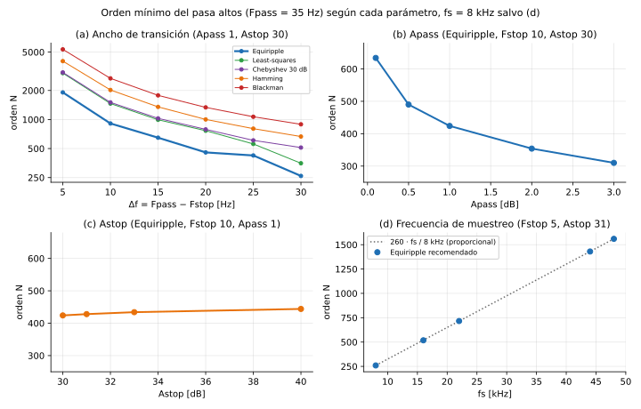

*(a) Achicar la transición dispara el orden, con cualquier método. (b) y (c) Bajar Apass encarece mucho más que subir Astop. (d) El orden es proporcional a fs.*

---

# Parte IV – Métodos de diseño

Las diapositivas del curso ordenan el diseño en cinco pasos. Para este TP, el ciclo queda así:

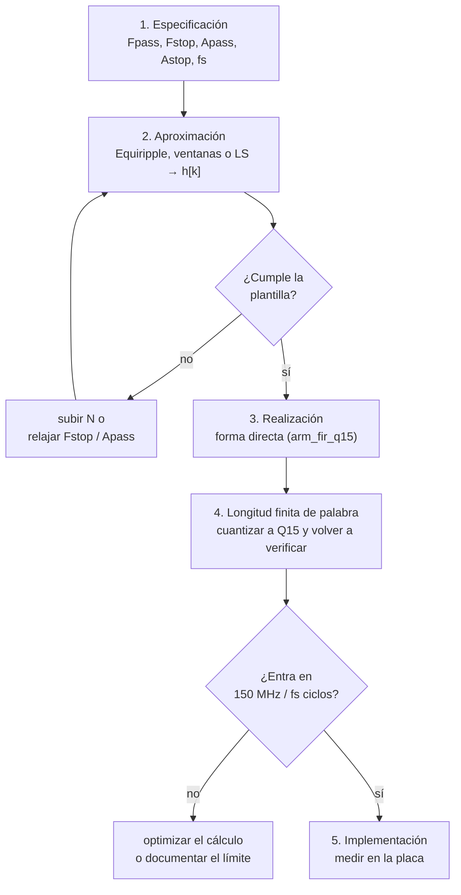

## 10. El filtro ideal y el efecto Gibbs

### 10.1 La respuesta al impulso del filtro ideal

Si se pide un pasa bajos ideal (ganancia 1 hasta $\omega_c$ y 0 después), la respuesta al impulso que lo produce es una **sinc**:

$$h_{ideal}[n] = \frac{\sin(\omega_c n)}{\pi n}$$

Tiene dos problemas:

- **Es infinita:** va de $n = -\infty$ a $+\infty$, decayendo de a poco. No se puede guardar.
- **No es causal:** tiene valores para $n < 0$, que corresponden a muestras futuras.

### 10.2 La solución directa: truncar y correr

1. Quedarse con $N+1$ muestras alrededor del centro.
2. Correrlas $N/2$ muestras para que empiecen en $n = 0$. Ese corrimiento es el retardo de grupo.

### 10.3 El efecto Gibbs

Al cortar la sinc de golpe aparece un **sobrepico de ≈ 9 %** cerca del corte, que se traduce en una atenuación máxima de solo **≈ 21 dB** en la banda de rechazo.

Lo importante: **el sobrepico no baja al aumentar N.** Agrandar N solo lo comprime hacia el borde. Por eso truncar no alcanza para los 30 dB de la consigna, y hacen falta las ventanas o los métodos óptimos.

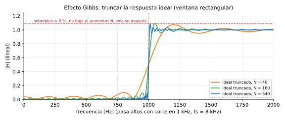

*Con N = 40, 160 y 640 el sobrepico sigue en ≈ 9 %: solo se angosta.*

## 11. Método de ventanas

### 11.1 Qué hace una ventana

En lugar de cortar la sinc de golpe (que es multiplicarla por un rectángulo), se la multiplica por una **ventana** $w[n]$ que va **suavemente a cero** en los extremos:

$$h[n] = h_{ideal}[n - N/2] \cdot w[n]$$

Al no haber un corte brusco, el sobrepico baja.

### 11.2 Qué se gana y qué se pierde

Multiplicar en el tiempo equivale a "suavizar" en frecuencia con el espectro de la ventana. Ese espectro tiene dos partes:

- **Lóbulo principal:** su ancho fija el **ancho de la transición**. Angosto es mejor.
- **Lóbulos laterales:** su altura fija la **atenuación**. Bajos es mejor.

**Ninguna ventana mejora las dos cosas a la vez.** Una ventana más suave baja los lóbulos laterales (más atenuación) pero ensancha el principal (transición más ancha, o sea, más orden).

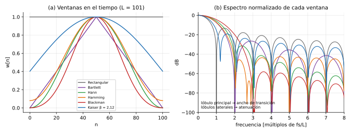

*Rectangular: lóbulo principal angosto y lóbulos laterales altos (−13 dB). Blackman: lóbulos muy bajos y lóbulo principal ancho. Kaiser con β = 2,12 queda en el medio, ajustada a 30 dB.*

| Ventana | Atenuación mínima de rechazo | Ancho de transición (Δf/fs ≈) | ¿Sirve para 30 dB? |
|---|---|---|---|
| Rectangular | ≈ 21 dB | 0,9 / L | **no** |
| Bartlett (triangular) | ≈ 25 dB | ≈ 3 / L | **no** |
| Hann | ≈ 44 dB | 3,1 / L | sí, con atenuación de sobra |
| Hamming | ≈ 53 dB | 3,3 / L | sí, con atenuación de sobra |
| Blackman | ≈ 74 dB | 5,5 / L | sí, con muchísima de sobra |
| Kaiser (β) | ajustable con β | ajustable | **sí, justa** |
| Chebyshev | ajustable | ajustable | sí |

**Cómo leer la tabla para el TP.** Como piden solo 30 dB, las ventanas fijas (Hann, Hamming, Blackman) dan atenuación de sobra y la pagan con transiciones más anchas, o sea, más coeficientes. Kaiser permite ajustar β a lo justo:

```
β = 0,5842·(A − 21)^0,4 + 0,07886·(A − 21)     (para A entre 21 y 50 dB)

A = 30:  β = 0,5842 · 9^0,4 + 0,07886 · 9 = 1,407 + 0,710 = 2,12
```

### 11.3 La limitación de fondo de las ventanas

Con ventanas, **el ripple de la banda de paso sale igual al de la de rechazo** ($\delta_p = \delta_s$). La consigna pide δs = 0,0316 (30 dB) pero permite δp = 0,0575 (1 dB). Como la ventana obliga a cumplir 0,0316 en las dos bandas, la banda de paso queda mejor de lo necesario, y esa "calidad de más" se paga con coeficientes.

*Scale passband* (opción de Window en `filterDesigner`) normaliza los coeficientes para que la ganancia en el centro de la banda de paso sea exactamente 1. En un pasa altos, ese centro es Nyquist.

## 12. Métodos óptimos

### 12.1 Equiripple (Parks-McClellan / Remez)

**Qué hace.** Plantea el diseño como un problema de optimización: buscar los coeficientes que hacen **lo más chico posible el peor error** entre la respuesta real y la ideal, en las bandas especificadas (criterio *minimax*).

**Intuición.** Pensá el error como un presupuesto:

- Las ventanas "gastan" el error de forma despareja: mucho cerca del corte y casi nada lejos. Ese error de más que dejan lejos del corte es desperdicio.
- Equiripple **reparte el error parejo**: hace que la respuesta oscile con la **misma amplitud** de borde a borde de la tolerancia, en toda la banda. Eso es lo que significa "equiripple" (ripple igual), y se ve en la figura de la plantilla (8.1), panel (b).

El **teorema de alternancia** garantiza que esa solución pareja es la mejor posible: el error máximo se alcanza en al menos N/2 + 2 frecuencias, alternando de signo. El algoritmo de Remez busca esas frecuencias iterando.

**Por qué gana en este TP:**

- Usa pesos distintos en cada banda ($1/\delta_p$ y $1/\delta_s$), así que respeta **δp y δs por separado**. No gasta precisión donde no se pide.
- **Es óptimo en un sentido preciso:** para una plantilla dada, da el **menor orden posible** entre los FIR de fase lineal.

### 12.2 Mínimos cuadrados (Least-squares)

Minimiza la **energía** del error (el promedio de los errores al cuadrado) en lugar del peor error. Logra mejor atenuación **en promedio**, pero deja picos cerca de los bordes.

Como la consigna pide una atenuación **mínima** (Astop: "en ningún punto peor que 30 dB"), lo que importa es el peor caso, y Equiripple lo resuelve con menos orden.

### 12.3 Muestreo en frecuencia

Se fijan los valores deseados de $H$ en L frecuencias equiespaciadas y se obtiene $h$ con una DFT inversa. Es simple, pero controla mal lo que pasa entre esas frecuencias. Aparece en el curso como método, pero no conviene para este TP.

### 12.4 ¿"Óptimo" para qué?

| Si lo que importa es… | El óptimo es |
|---|---|
| el menor orden que cumple una plantilla (Apass, Astop) con fase lineal | **Equiripple** |
| el menor error promedio | Least-squares |
| la menor cantidad de cuentas por muestra | IIR, o estructuras especiales (promedios móviles recursivos, multietapa) |
| el menor retardo | FIR de fase mínima o IIR (se pierde la fase lineal) |

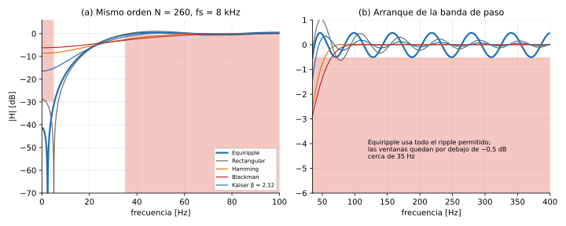

*Con el mismo N = 260, solo Equiripple respeta la plantilla. Las ventanas (con el corte en el medio de la transición, 20 Hz) no llegan a −30 dB en 0–5 Hz: necesitarían 2 o 3 veces más coeficientes.*

## 13. El pasa altos en particular

### 13.1 Inversión espectral: pasa altos = señal − pasa bajos

Un pasa altos se puede armar con un pasa bajos:

$$h_{PA}[n] = \delta[n - M] - h_{PB}[n] \qquad (M = N/2)$$

**Cómo se lee:** "la señal retardada menos su parte lenta".

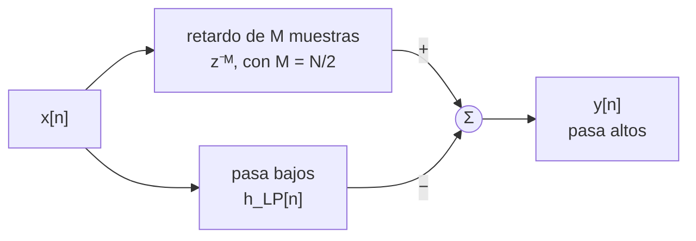

**Por qué funciona:**

```
Frecuencias bajas: el pasa bajos deja pasar casi todo (ganancia ≈ 1)
                   → salida = señal − señal ≈ 0              rechazo
Frecuencias altas: el pasa bajos no deja pasar nada (≈ 0)
                   → salida = señal − 0 = señal              pasa
```

El retardo $M$ hace falta para que la señal directa y la que pasa por el pasa bajos estén **alineadas en el tiempo** antes de restarlas, porque el pasa bajos de fase lineal las atrasa $M$ muestras.

Hay tres consecuencias que se ven en los coeficientes:

1. **El coeficiente central vale casi 1** (0,9948 en el diseño recomendado): es el δ[n − M] menos un poquito del pasa bajos.
2. **El resto son chicos y negativos:** son el pasa bajos con el signo cambiado.
3. **N tiene que ser par**, para que el centro $M = N/2$ caiga en una muestra entera (es otra forma de ver lo del tipo I, sección 7.4).

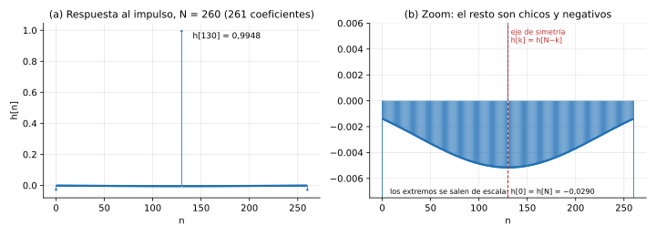

*Un coeficiente central ≈ 1 (el retardo) más un pasa bajos chico con signo negativo, simétrico respecto de n = 130.*

### 13.2 Qué le pasa a cada tipo de señal

| Entrada | Salida esperada del pasa altos | Por qué |
|---|---|---|
| Continua (offset) | eliminada: la salida queda centrada en 2048 | 0 Hz está en la banda de rechazo |
| Senoidal de 1–5 Hz | atenuada ≥ 30 dB (2 Vpp → ≤ 63 mVpp) | banda de rechazo |
| Senoidal de 10–30 Hz | atenuada parcialmente | banda de transición: vale cualquier valor |
| Senoidal ≥ 35 Hz | pasa con ≤ 1 dB de error, retrasada 16,25 ms | banda de paso |
| Cuadrada de baja frecuencia (5 Hz) | un pulso en cada flanco, que arranca antes del flanco y decae después | la fundamental (5 Hz) se elimina y quedan los armónicos altos, que forman los flancos |

### 13.3 La respuesta en el tiempo

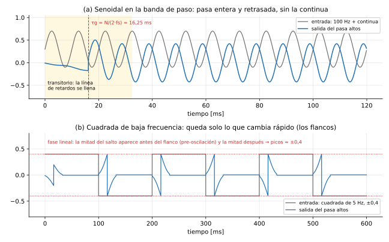

*Simulación con los coeficientes del diseño recomendado a 8 kHz. (a) 100 Hz con continua: sale sin la continua y retrasada 16,25 ms, después de un transitorio de N muestras. (b) Cuadrada de 5 Hz: por la fase lineal, la mitad de cada salto aparece antes del flanco y la otra mitad después.*

**Cómo leer el panel (a):**

- Durante los primeros 32,5 ms (N muestras), la línea de retardos se está llenando y la salida todavía no es válida: es el **transitorio**. Pasa cada vez que se cambia de filtro, porque `estado_fir` se pone en cero.
- Después, la salida es la misma senoidal, **sin la continua** (centrada en 0) y **atrasada 16,25 ms**.

**Cómo leer el panel (b):** el flanco de una cuadrada de −A a +A es un salto de 2A, pero la salida **no llega a 2A**. Como el filtro es simétrico, la respuesta al salto también lo es: la mitad del salto aparece antes del flanco (la salida baja hasta ≈ −A) y la otra mitad después (sube a ≈ +A). Los picos quedan en ≈ ±A, la misma amplitud de la entrada.

Que algo aparezca "antes" del flanco no viola la causalidad: toda la salida está atrasada $\tau_g$, así que ese "antes" sigue siendo después de que el flanco entró al filtro.

## 14. `filterDesigner`: cada campo y su teoría

| Campo | Qué es en teoría | Sección |
|---|---|---|
| Response Type: Highpass | forma de la respuesta deseada: 0 en el rechazo, 1 en el paso | 8 |
| Design Method: FIR → Equiripple / Window / Least-squares | criterio de aproximación | 11, 12 |
| Filter Order: Minimum / Specify | buscar el N mínimo que cumple la plantilla, o fijar N a mano | 9 |
| Options → Density factor (Equiripple) | cuántos puntos de frecuencia usa Remez para evaluar el error. El valor por defecto (16) anda bien | 12.1 |
| Options → Window, Beta, Scale passband (Window) | tipo de ventana, β de Kaiser, normalización de la ganancia | 11 |
| Units, Fs | escala en Hz. **Fs fija la conversión a ω** | 2.4 |
| Fstop, Fpass | bordes de la plantilla | 8.2 |
| Astop, Apass | δs y δp, en dB | 8.3 |
| Fc (Window con Specify order) | punto de −6 dB | 8.4 |
| Analysis → Magnitude / Phase / Group delay / Impulse response | $\lvert H\rvert$, fase, $\tau_g$, $h[n]$ | 5, 7 |
| Set quantization parameters → Fixed-point 16/15 | simula los coeficientes en Q15 | 16.4 |
| Export / Generate C header | entrega $h[n]$ para armar `filtros.h` | 17 |

---

# Parte V – Implementación

## 15. Estructuras de realización

### 15.1 Forma directa: la línea de retardos

Se guardan las últimas L entradas en una "fila" $w_0, w_1, \dots, w_N$. En cada muestra:

1. Se calcula la salida: $L$ multiplicaciones-acumulaciones (MAC).
2. Se corre la fila un lugar y entra la muestra nueva.

Es lo que muestran las diapositivas (`w3 = w2; w2 = w1; w1 = w0`) y lo que hace `arm_fir_q15`. Para N = 3:

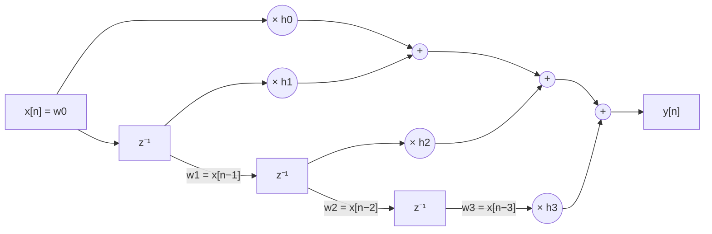

**Ejemplo paso a paso** de cómo se mueve la fila con la entrada `x = 5, 7, 2, 9, …`:

```
n    entra   w0   w1   w2   w3      y[n] = h0·w0 + h1·w1 + h2·w2 + h3·w3
0    5       5    0    0    0       h0·5
1    7       7    5    0    0       h0·7 + h1·5
2    2       2    7    5    0       h0·2 + h1·7 + h2·5
3    9       9    2    7    5       h0·9 + h1·2 + h2·7 + h3·5
4    …       …    9    2    7       la muestra 5 ya salió de la fila
```

Con 261 coeficientes la fila tiene 261 lugares: cada muestra nueva implica **261 MAC y correr 260 valores**.

### 15.2 Otras estructuras

| Estructura | Idea | Ventaja |
|---|---|---|
| **Transpuesta** | reordena sumas y retardos | otra organización de registros, misma salida |
| **Fase lineal** | aprovecha $h[k] = h[N-k]$: suma primero las dos muestras que comparten coeficiente y multiplica una sola vez | **la mitad de multiplicaciones** |
| **Cascada** | factoriza el filtro en secciones de orden 2 | útil sobre todo en IIR |

### 15.3 Buffer circular

Correr la fila cuesta una copia por coeficiente en cada muestra. Un **buffer circular** lo evita: en lugar de mover los datos, se mueve **un índice** que indica dónde está la muestra más nueva. Cuando el índice llega al final, vuelve al principio. Es la misma idea del buffer de 512 muestras que pide la consigna (`index_buffer` en `TP2.c`).

## 16. Punto fijo Q15

### 16.1 El formato

Un `q15_t` es un `int16_t` (entero de −32768 a 32767) que se **interpreta** como una fracción:

$$\text{valor} = \frac{\text{entero}}{32768}$$

| Entero guardado | Valor que representa |
|---|---|
| 32767 | 0,99997 (≈ 1, el máximo) |
| 16384 | 0,5 |
| 1 | 0,0000305 (la resolución) |
| 0 | 0 |
| −16384 | −0,5 |
| −32768 | −1 (el mínimo) |

La resolución es $2^{-15} \approx 3{,}05 \times 10^{-5}$, es decir, −90,3 dB.

**Por qué se usa:** el Cortex-M33 hace multiplicaciones enteras de 16 bits muy rápido, incluso de a dos por instrucción (SIMD, `__SMLALD`). Con punto flotante sería más lento.

**Pasaje de un coeficiente a Q15:**

```
h = −0,0051544      (un coeficiente del pasa altos)
× 32768             = −168,90
redondeo            = −169          ← lo que se guarda en filtros.h
valor real          = −169 / 32768 = −0,0051575
error               = 0,0000031     (menos de medio escalón)
```

### 16.2 Cómo se multiplica

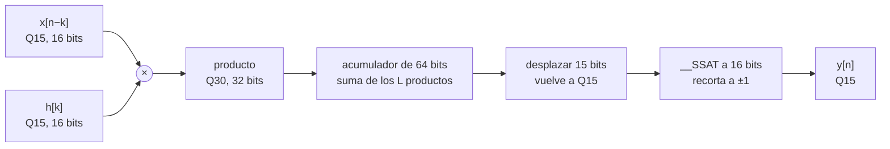

**Ejemplo paso a paso:** 0,5 × 0,5.

```
0,5 en Q15 = 16384

1) multiplicar los enteros:    16384 × 16384 = 268 435 456
   Ese número tiene 30 bits fraccionarios (Q30): 268 435 456 / 2^30 = 0,25 ✓

2) volver a Q15, desplazando 15 bits a la derecha:
   268 435 456 >> 15 = 8192   →   8192 / 32768 = 0,25 ✓
```

**Por qué un acumulador de 64 bits.** Cada producto ocupa hasta 31 bits. Si se suman 261 productos en un acumulador de 32 bits, el total puede desbordar. Con 64 bits sobra lugar, y `arm_fir_q15` usa 64.

### 16.3 Saturación: recortar en lugar de "dar la vuelta"

Si el resultado final se pasa de ±1, hay dos comportamientos posibles:

```
Sin saturación (enteros comunes):   32767 + 1 = −32768    ← el máximo positivo pasa a ser el mínimo negativo
Con saturación (__SSAT):            32767 + 1 = 32767     ← se queda en el máximo
```

Sin saturación, una señal que se pasa un poquito produce un salto enorme, de +1 a −1, que se oye como un "click" y se ve como una espiga en el osciloscopio. Con saturación, la señal solo se "aplana" en el borde. CMSIS satura siempre.

### 16.4 Cuantización de coeficientes

Redondear cada coeficiente a Q15 (como en el ejemplo de 16.1) cambia un poco la respuesta en frecuencia:

- **La atenuación de rechazo puede empeorar.** Un diseño hecho justo en 30 dB quedó en −29,7 dB después de cuantizar. Por eso se diseña con **Astop = 31 dB**: ese margen absorbe el error.
- **En filtros muy largos** (44/48 kHz), muchos coeficientes son menores que medio escalón y **se redondean a 0**. Es información del filtro que se pierde.
- **En un FIR esto nunca lo vuelve inestable**, porque no tiene polos. En un IIR sí puede pasar.

En `filterDesigner` se puede ver antes de exportar, con *Set quantization parameters*.

### 16.5 Ganancia máxima y desborde

La ganancia más grande que puede tener un FIR, para la peor entrada posible, es la suma de los valores absolutos de sus coeficientes:

```
peor caso = |h[0]| + |h[1]| + … + |h[N]|
  pasa altos recomendado:           ≈ 2,0
  pasa altos actual de filtros.h:   2,45
```

Es una **cota para el peor caso**: una entrada armada a propósito con los signos de los coeficientes. Con senoidales y cuadradas la salida queda en la amplitud de la entrada (sección 13.3). Si igual se teme saturación, hay dos opciones: bajar la amplitud del generador, o escalar los coeficientes, perdiendo resolución.

## 17. CMSIS-DSP: `arm_fir_q15`

```c
arm_fir_instance_q15 S;                                   /* instancia: numTaps, pState, pCoeffs */
arm_fir_init_q15(&S, numTaps, coefs, estado, BLOCK_SIZE); /* una vez, al arrancar */
arm_fir_q15(&S, &entrada[i], &salida[i], BLOCK_SIZE);     /* en la ISR, en cada muestra */
```

| Elemento | Qué es en teoría | Restricción y por qué |
|---|---|---|
| `pCoeffs` | los coeficientes $h[k]$ | **orden invertido**: $h[N]$ primero y $h[0]$ último. Para un filtro simétrico da lo mismo |
| `numTaps` | L, la cantidad de coeficientes | **par y ≥ 4**, porque CMSIS procesa de a pares. Si L es impar (el tipo I siempre lo es), se agrega **un cero** al final, que no cambia la respuesta: 261 → 262 |
| `pState` | la línea de retardos (sección 15.1) | largo `numTaps + blockSize`. Se pone en cero al cambiar de filtro, para no mezclar muestras viejas de otro filtro |
| `blockSize` | cuántas muestras procesa cada llamada | `1` = procesamiento por muestra (lo que pide la consigna) |

### 17.1 Por muestra frente a por bloque

| | Por muestra (`blockSize = 1`) | Por bloque (por ejemplo, 32) |
|---|---|---|
| Latencia | mínima: la salida sale en la misma interrupción | se agrega un bloque de retardo |
| Eficiencia | baja: costos fijos en cada llamada, y CMSIS no puede usar su lazo vectorizado ni evitar la copia del estado | alta: los costos fijos se reparten entre 32 muestras |
| Complejidad | simple | necesita doble buffer |

La consigna pide por muestra.

## 18. Tiempo real

### 18.1 La regla

**Todo el trabajo de una muestra tiene que terminar antes de que llegue la siguiente.** El micro corre a 150 MHz:

```
ciclos disponibles por muestra = 150 000 000 / fs
```

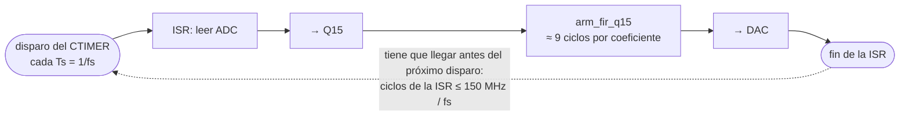

### 18.2 La cuenta, paso a paso

Costo estimado de `arm_fir_q15` con `blockSize = 1`: ≈ 9 ciclos por coeficiente (MAC + copia del estado), más ≈ 200 ciclos fijos de la ISR. **Es una estimación: hay que medirlo.**

```
fs = 8 kHz:
  disponibles:  150 000 000 / 8000 = 18 750 ciclos
  necesarios:   262 coef × 9 + 200 = 2 558 ciclos
  carga:        2 558 / 18 750     = 14 %          ✓ entra

fs = 48 kHz:
  disponibles:  150 000 000 / 48000 = 3 125 ciclos
  necesarios:   1562 coef × 9 + 200 = 14 258 ciclos
  carga:        14 258 / 3 125      = 456 %        ✗ no entra (haría falta un micro 4,6 veces más rápido)
```

| fs | Disponibles | Necesarios (recomendado) | Carga |
|---|---|---|---|
| 8 kHz | 18 750 | 2 558 | 14 % ✓ |
| 16 kHz | 9 375 | 4 880 | 52 % ✓ |
| 22 kHz | 6 818 | 6 662 | 98 % ⚠ |
| 44 kHz | 3 409 | 13 088 | 384 % ✗ |
| 48 kHz | 3 125 | 14 258 | 456 % ✗ |

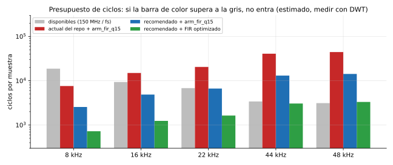

*Estimación con ≈ 9 ciclos por coeficiente para arm_fir_q15 con blockSize = 1 y ≈ 2 para un FIR optimizado con simetría. Hay que medirlo en la placa.*

### 18.3 Por qué la carga crece con fs²

Al subir fs pasan **dos cosas a la vez**:

1. **Hay menos tiempo por muestra:** los ciclos disponibles bajan como 1/fs.
2. **Hacen falta más coeficientes:** el orden sube proporcional a fs (sección 9).

```
de 8 a 48 kHz (× 6):
  disponibles:  ÷ 6
  necesarios:   × 6
  carga:        × 36   (aproximadamente: 14 % × 36 ≈ 500 %)
```

Ese es el motivo de fondo por el que el pasa altos de 35 Hz no entra a 44/48 kHz con `arm_fir_q15`.

### 18.4 Qué pasa si no entra

Si la ISR tarda más que $T_s$:

- Se pierden conversiones del ADC, y la fs efectiva baja. Eso cambia la respuesta del filtro en Hz (sección 2.4).
- La salida se distorsiona.
- Los botones pueden dejar de responder: el procesador nunca sale de la interrupción.

**La carga se mide, no se supone.** Hay dos formas: con el contador de ciclos DWT, o con un GPIO que se pone en alto al entrar a la ISR y en bajo al salir, y se mide el ancho del pulso en el osciloscopio. El procedimiento está en la sección 11 del análisis.

### 18.5 Dos retardos que no hay que confundir

| | Latencia de cómputo | Retardo de grupo del filtro |
|---|---|---|
| Qué es | lo que tarda la ISR en calcular | lo que el filtro atrasa la señal |
| Orden de magnitud | µs | ms (16,25 ms a 8 kHz) |
| Depende de | la velocidad del micro | solo de N y fs: $N/(2 f_s)$ |
| Se achica con un micro más rápido | sí | **no** |

---

# Parte VI – Medición y repaso

## 19. Medición en el osciloscopio

### 19.1 Procedimiento

1. **Referencia:** con el filtro en BYPASS, medí la amplitud de salida (Vpp). Así incluís la ganancia propia de la cadena ADC → DAC.
2. **Barrido:** con el pasa altos activo, medí la salida a varias frecuencias. Para cada una calculá la ganancia contra BYPASS:

   ```
   G = 20 · log10( Vpp_filtro / Vpp_bypass )
   ```

3. **Comparación:** armá la curva y comparala con la de `filterDesigner`.

### 19.2 Qué esperar con 2 Vpp (pasa altos recomendado, 8 kHz)

| Frecuencia | Zona | Ganancia esperada | Vpp esperado |
|---|---|---|---|
| 1 Hz, 3 Hz, 5 Hz | rechazo | ≤ −30 dB | ≤ 63 mVpp |
| 10, 20 Hz | transición | entre −30 y 0 dB | entre 63 mVpp y 2 Vpp |
| 35 Hz | borde de paso | ≈ −0,5 dB | ≈ 1,89 Vpp |
| 100 Hz, 1 kHz | paso | −0,5 a +0,5 dB | 1,89 a 2,11 Vpp |

### 19.3 Consejos prácticos

- **Retardo:** con un seno en la banda de paso, el corrimiento entre la entrada y la salida es ≈ $\tau_g$ (16,25 ms) más la latencia de cómputo (µs).
- **Acople DC** en el osciloscopio para ver el recentrado de la sección 3.3. En acople AC no se ve.
- **Señales chicas:** a −30 dB la salida es de decenas de mVpp. Usá la mayor amplitud que no sature y el promediado del osciloscopio para bajar el ruido.
- **FFT del osciloscopio:** con una cuadrada o con ruido a la entrada, se ve directamente el espectro de salida y cómo el filtro "apaga" la zona de rechazo.
- **Aliasing:** a fs = 8 kHz, subí el generador de 4 a 8 kHz y observá cómo la salida baja de 4 a 0 kHz (sección 2.3).

## 20. El razonamiento completo, en orden

1. La señal analógica se **muestrea** a $f_s$. Las frecuencias pasan a la escala digital $\omega = 2\pi f/f_s$, y lo que esté por encima de $f_s/2$ se dobla (aliasing).
2. Se **cuantiza** a 16 bits y se **centra** en 0 (Q15). El ruido de cuantización fija el piso, y en la salida manda el DAC: ≈ −74 dB.
3. El filtro es un **sistema LTI**: una suma pesada de las últimas L muestras (convolución). En frecuencia, multiplica cada senoidal por su ganancia.
4. Un **FIR** es siempre estable. Con coeficientes **simétricos** tiene **fase lineal**: retardo constante de N/2 muestras y sin deformar la señal.
5. El filtro ideal no existe, así que se especifica una **plantilla**: Fpass, Fstop, Apass, Astop. La consigna da Fc y Astop, y el resto es **decisión de diseño** que hay que justificar.
6. El **orden** necesario es proporcional a $f_s$ y a la atenuación, e inversamente proporcional al ancho de la transición. Un corte en 35 Hz con fs de kHz da cientos o miles de coeficientes.
7. **Equiripple** da el menor orden para una plantilla, porque reparte el error parejo. Las ventanas son más simples, pero sobredimensionan.
8. Los coeficientes se pasan a **Q15**. La cuantización degrada el rechazo, así que se diseña con margen (31 dB).
9. CMSIS `arm_fir_q15` hace la convolución en punto fijo con acumulador de 64 bits y saturación. Pide coeficientes invertidos, `numTaps` par y un estado.
10. Todo tiene que entrar en **150 MHz / fs ciclos**. La carga crece con $f_s^2$, y eso limita qué filtros entran en tiempo real a fs altas.
11. Se **verifica** midiendo: barrido contra BYPASS, ganancia en dB y medición de ciclos.

## 21. Preguntas de autoevaluación

<details>
<summary>Si la entrada es de 2 Vpp y Astop = 30 dB, ¿cuánto tengo que medir en la banda de rechazo?</summary>

Factor = 10^(−30/20) = 0,0316. Salida máxima = 2 × 0,0316 = 63 mVpp. Si medís menos, cumple.
</details>

<details>
<summary>¿Por qué la SNR es positiva y el "piso de ruido" es negativo?</summary>

Es el mismo cociente dado vuelta. La SNR compara señal/ruido: como la señal es mayor, da positiva (+74 dB). El piso de ruido compara ruido/señal (o ruido/fondo de escala): como el ruido es más chico, da negativo (−74 dB).
</details>

<details>
<summary>A fs = 8 kHz entra una senoidal de 5 kHz. ¿Qué sale?</summary>

Una senoidal de 3 kHz (|5 − 8| = 3). Supera Nyquist (4 kHz) y se dobla. El filtro la ve como 3 kHz y no la puede eliminar como si fuera de 5 kHz.
</details>

<details>
<summary>¿Por qué se resta 32768 a convValue?</summary>

Porque el ADC entrega 0…65535 (sin signo, centro en 32768) y Q15 es con signo (−32768…32767). La resta centra la señal en 0 y la hace entrar en un int16. Sin la resta, la mitad de arriba de la señal se daría vuelta a negativo.
</details>

<details>
<summary>¿Por qué hacen falta coeficientes distintos para cada fs?</summary>

Porque los coeficientes definen la respuesta en ω (radianes por muestra), y la frecuencia en Hz es f = ω · fs / 2π. Los mismos coeficientes a 48 kHz cortan 6 veces más arriba que a 8 kHz.
</details>

<details>
<summary>¿Por qué el pasa altos tiene tantos coeficientes si solo pide 30 dB?</summary>

Porque el orden depende sobre todo del ancho de transición comparado con fs (Δf/fs), no de la atenuación. Para distinguir 5 Hz de 35 Hz el filtro tiene que "mirar" ~1/30 s de señal, que son ~267 muestras a 8 kHz.
</details>

<details>
<summary>¿Por qué el orden del pasa altos tiene que ser par?</summary>

Un FIR simétrico de orden impar (tipo II) tiene ganancia cero en Nyquist, porque los pares de coeficientes se cancelan con la entrada 1, −1, 1, −1… El pasa altos necesita ganancia 1 ahí. Además, la inversión espectral necesita un centro M = N/2 entero.
</details>

<details>
<summary>¿Qué garantiza la fase lineal y cómo se ve en el osciloscopio?</summary>

Que todas las frecuencias se atrasan lo mismo (N/2 muestras), así que la forma de onda en la banda de paso no se deforma. Se ve como un corrimiento constante, de 16,25 ms para N = 260 a 8 kHz.
</details>

<details>
<summary>¿Por qué Equiripple da menos orden que Kaiser?</summary>

Porque reparte el error parejo en cada banda y respeta δp y δs por separado. La ventana obliga a δp = δs y concentra el error cerca del corte, así que sobra precisión en algún lado y eso cuesta coeficientes.
</details>

<details>
<summary>¿Qué pasa si la ISR tarda más que Ts?</summary>

Se pierden muestras, la fs efectiva baja (y con ella cambia el corte en Hz), la salida se distorsiona y los botones pueden dejar de responder.
</details>

<details>
<summary>¿Por qué diseñar con 31 dB si piden 30?</summary>

Porque redondear los coeficientes a Q15 degrada la atenuación unas décimas de dB. El margen asegura que cumpla el filtro **implementado**, no solo el diseñado.
</details>

<details>
<summary>¿Por qué se pone en cero el estado al cambiar de filtro?</summary>

El estado es la línea de retardos, con las últimas muestras de entrada. Si no se limpia, el filtro nuevo arranca con datos de otra configuración. Igual hay un transitorio de N muestras mientras la línea se llena.
</details>

## 22. Fórmulas clave

| Concepto | Fórmula | Cómo leerla |
|---|---|---|
| Ganancia en dB | `dB = 20 · log10(salida / entrada)` | negativo = se achica |
| dB a factor | `factor = 10^(dB/20)` | −30 dB → × 0,0316 |
| Frecuencia digital | `ω = 2π · f / fs` | ángulo que gira la onda por muestra |
| Nyquist | `f < fs / 2` | más de 2 muestras por ciclo |
| Frecuencia alias | `\|f − k·fs\|`, con el resultado entre 0 y fs/2 | 5 kHz a 8 kHz → 3 kHz |
| SNR de cuantización | `SNR ≈ 6,02·B + 1,76 dB` | +6 dB por bit |
| Convolución (FIR) | `y[n] = Σ h[k] · x[n−k]` | suma pesada de las últimas L muestras |
| Ripple lineal | `δp = (10^(Ap/20) − 1) / (10^(Ap/20) + 1)`, `δs = 10^(−As/20)` | 1 dB → ±0,0575; 30 dB → 0,0316 |
| Orden (Kaiser) | `N ≈ (A − 7,95) / (14,36 · Δf / fs)` | proporcional a fs, inverso a Δf |
| β de Kaiser (21–50 dB) | `β = 0,5842·(A−21)^0,4 + 0,07886·(A−21)` | 30 dB → 2,12 |
| Retardo de grupo | `τg = N / (2·fs)` | 260 a 8 kHz → 16,25 ms |
| Pasa altos por inversión | `h_PA[n] = δ[n − N/2] − h_PB[n]` | señal retardada menos su parte lenta |
| Q15 | `valor = entero / 32768` | 16384 = 0,5 |
| Ciclos por muestra | `150 MHz / fs` | 18 750 a 8 kHz, 3 125 a 48 kHz |

## Bibliografía

- S. J. Orfanidis, *Introduction to Signal Processing* (material de estudio indicado en las diapositivas del curso): cap. 1 (muestreo), cap. 4 (FIR y convolución), cap. 10 (diseño de FIR: ventanas y Kaiser).
- Diapositivas del curso, *Filtros Digitales* y *Filtros FIR y MATLAB* (carpeta `archivos/`).
- A. V. Oppenheim, R. W. Schafer, *Discrete-Time Signal Processing*: cap. 5 (fase lineal y tipos I–IV) y cap. 7 (Parks-McClellan).
- Documentación de CMSIS-DSP, `arm_fir_q15` y `arm_fir_init_q15`.
